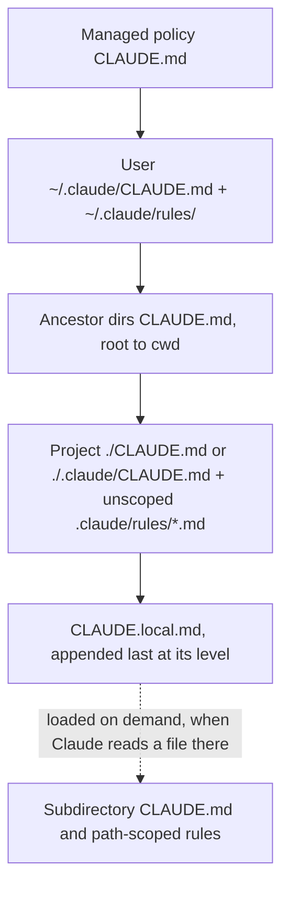
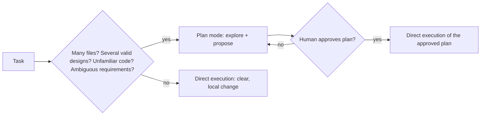
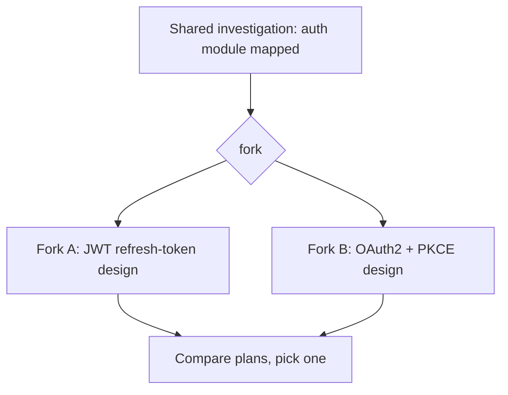

# Chapter 5 — Claude Code: Configuration and Workflows

> **Exam domain(s):** Domain 3 — Claude Code Configuration & Workflows (20%) is the main one. This chapter also covers parts of Domain 1 — Agentic Architecture & Orchestration (27%, task 1.7 sessions, resume and fork), Domain 4 — Prompt Engineering & Structured Output (20%, task 4.6 multi-instance review) and Domain 5 — Context Management & Reliability (15%, task 5.4 large-codebase context).
> **Exam scenarios:** *Code Generation with Claude Code* and *Claude Code for Continuous Integration*
> **Est. time:** 7–9 hours (reading 2.5 h, notebooks 4.5–6.5 h) · **Status:** [ ] not started

---

## Why this matters for a solution architect

Claude Code is the reference implementation of the agent loop you studied in [Chapter 3](../03-agent-sdk/README.md). It is also how most teams first put Claude into their daily work. As the architect, you decide where each piece of team knowledge lives:

- always-loaded instructions (CLAUDE.md)
- conditional rules (`.claude/rules/`)
- on-demand workflows (skills)
- hard enforcement (permissions and hooks)

You also decide how the same agent runs unattended in CI. Each choice trades **context cost** against **reliability** and **team consistency**. The exam tests these trade-offs directly. It does not test syntax trivia.

## Learning objectives

- [ ] Place an instruction at the correct CLAUDE.md scope (managed, user, project, local, subdirectory) and explain when each file loads
- [ ] Split a large CLAUDE.md into modules with `@path` imports and `.claude/rules/`, and know that imports organize the file but do **not** reduce its context cost
- [ ] Write path-scoped rules with `paths:` glob frontmatter for conventions that cut across directories (tests, migrations, IaC)
- [ ] Build a project skill (`.claude/skills/<name>/SKILL.md`) with `description`, `argument-hint`, `context: fork`, `agent`, `allowed-tools` and `disable-model-invocation`, and explain how skills replaced custom commands
- [ ] Choose between plan mode and direct execution, and use the Explore subagent to keep verbose discovery out of the main context
- [ ] Manage context in long sessions with `/compact`, `/context`, `/clear` and `/memory`, and know what survives compaction
- [ ] Run Claude Code headless in CI with `-p`, `--output-format json`, `--json-schema`, `--allowedTools`, `--max-turns` and `--bare`
- [ ] Resume, name and fork sessions (`--resume`, `-n`, `--fork-session`, `/branch`, and the Agent SDK `fork_session=True`), and know when a fresh session beats a resumed one
- [ ] Iterate with Claude Code: concrete input/output examples, test-first loops that feed failures back, the interview pattern, and one message for interacting issues vs one at a time for independent ones
- [ ] Explain how Claude Code works (agentic loop, tools, context window, permission modes), install it on each surface, run `/init`, follow explore → plan → code → commit, and stream headless output with `stream-json`
- [ ] Tell Claude Code (development automation) from Computer Use (GUI automation), and choose between the Computer Use API toolset you host and computer use inside Claude Code

## Prerequisites

- [00 — Prerequisites](../../00-prerequisites/README.md): Python env, `.env` with `ANTHROPIC_API_KEY`, git basics
- [Chapter 3 — Agent SDK](../03-agent-sdk/README.md): the agent loop, tools, subagents, sessions. Claude Code *is* the Agent SDK with a terminal UI.
- [Chapter 4 — Model Context Protocol](../04-model-context-protocol/README.md): `.mcp.json` project scope and `${ENV_VAR}` substitution, which this chapter reuses
- Claude Code installed and signed in (`claude --version` works). See the [setup guide](https://code.claude.com/docs/en/setup).

---

## Concepts

### 5.1 The CLAUDE.md hierarchy

CLAUDE.md files are plain-markdown instructions that Claude Code reads at the start of every session. Several locations exist. They are **concatenated, not overridden**: every file that applies goes into context, from the broadest scope to the most specific.

| Scope | Location | Shared via git? | Typical content |
|---|---|---|---|
| Managed policy | `/Library/Application Support/ClaudeCode/CLAUDE.md` (macOS), `/etc/claude-code/CLAUDE.md` (Linux/WSL), `C:\Program Files\ClaudeCode\CLAUDE.md` (Windows) | Deployed by IT | Company security and compliance rules (cannot be excluded) |
| User | `~/.claude/CLAUDE.md` (+ `~/.claude/rules/`) | **No**, only you | Personal style, your shortcuts |
| Project | `./CLAUDE.md` **or** `./.claude/CLAUDE.md` | **Yes** | Build/test commands, architecture, team conventions |
| Local | `./CLAUDE.local.md` (add to `.gitignore`) | No | Your sandbox URLs, personal test data |
| Subdirectory | `packages/api/CLAUDE.md` | Yes | Conventions for that part of the tree |



Key loading rules:

- **At launch**, Claude Code loads CLAUDE.md and CLAUDE.local.md from the working directory and **every directory above it**.
- **Subdirectory** CLAUDE.md files below the working directory load **lazily**, the first time Claude reads a file in that subdirectory.
- Claude treats CLAUDE.md as **context, not enforcement**. If an action must never happen, use a permission `deny` rule or a `PreToolUse` hook (see [Chapter 3](../03-agent-sdk/README.md)).
- Keep each file short: the docs suggest **under ~200 lines**. Long files cost tokens in every session and lower adherence.
- Write instructions that are **concrete enough to verify**: "Use 2-space indentation", not "Format code properly"; "Run `npm test` before committing", not "Test your changes". Group them under headings, and remove contradictions, because Claude may follow either side of a conflict. If Claude keeps ignoring a rule, the file is probably too long and the rule is getting lost.
- `/init` generates a starter CLAUDE.md from your codebase (see 5.12). `/context` shows which memory files actually loaded.

> **Exam trap:** A new teammate does not get an instruction that everyone else follows. The cause is almost always that the instruction lives in the veterans' **user-level** `~/.claude/CLAUDE.md`. Move it to the **project** `CLAUDE.md` or `.claude/CLAUDE.md`, which is version-controlled. Distractors such as "Claude learns per-user preferences" or "clear the CLAUDE.md cache" describe features that do not exist.

> **Note: changed since the guide.** The guide lists three levels (user, project, directory). Current docs add **managed policy** and **`CLAUDE.local.md`**. Claude Code (v2.1.277+) also reads **`AGENTS.md`** by default when there is no `CLAUDE.md`, `.claude/CLAUDE.md` or `CLAUDE.local.md` in the working directory or above it (a `/config` setting can make it read both), which matters if you share a repo with OpenAI Codex (see [openai-codex](../../openai-codex/README.md)).

### 5.2 `@path` imports: modular CLAUDE.md

A CLAUDE.md can pull in other files with `@path`. Claude Code expands the imported file into context at launch, next to the file that imports it.

```markdown
# Project CLAUDE.md
Build with `make build`; run tests with `make test`.

- Coding standards: @./standards/coding-style.md
- Testing requirements: @./standards/testing.md
- Available scripts: @package.json
- Personal, cross-worktree prefs: @~/.claude/my-project-prefs.md
```

Rules that are worth remembering:

| Rule | Detail |
|---|---|
| Syntax | `@` directly before the path, no space. Escape spaces in a path as `\ `. |
| Path resolution | Relative paths resolve from **the file that contains the import**, not from the working directory. |
| Nesting | Imported files can import more files, up to **four hops** deep. |
| Code spans | Text in backticks (`` `@README` ``) is **not** imported. Use backticks to mention a path without loading it. |
| External imports | The first time a project-level memory file imports a path outside your working directory, Claude Code shows an approval dialog. If you decline, those imports stay disabled. Imports in your own user-level files (`~/.claude/CLAUDE.md`, `~/.claude/rules/`) load without the dialog. |
| Cost | Imports help **organization only**. The imported content still loads every session. |

Typical use in a monorepo: each package's CLAUDE.md imports only the shared standards that apply to it, for example `@../../standards/python.md` in a Python service and `@../../standards/react.md` in the frontend.

> **Note: changed since the guide.** The guide says the maximum import depth is 5. Current docs say **four hops**.

> **Exam trap:** "Use `@import` to split CLAUDE.md into category files" sounds like a fix for an overloaded context, but it is not one: imported files still load at launch. To make guidance load **conditionally**, use path-scoped rules (5.3). To make it load **on demand**, use skills (5.4).

### 5.3 `.claude/rules/`: topic files and path-scoped rules

`.claude/rules/` holds one markdown file per topic. Claude Code discovers files recursively, so `frontend/` and `backend/` subfolders work. Rules come in two kinds:

- **Unscoped rule** (no frontmatter): loads at launch, with the same priority as `.claude/CLAUDE.md`. It is a tidier way to split a monolithic file.
- **Path-scoped rule**: YAML frontmatter with `paths:` (the only field Claude Code reads). The rule loads **only when Claude reads, writes or edits a file whose path matches the glob**.

```markdown
---
paths:
  - "**/*.test.ts"
  - "**/*.test.tsx"
---
# Test conventions
- Use describe/it blocks; one behavior per `it`.
- Build fixtures with the factories in `test/factories/`; never hardcode IDs.
- Never mock the database. Use the dockerized test DB.
```

```markdown
---
paths: "terraform/**/*.tf, infra/**/*.tf"
---
# IaC rules
- Every resource must have `owner` and `cost_center` tags.
```

`paths` accepts either a YAML list or a comma-separated string. Brace expansion such as `src/**/*.{ts,tsx}` works.

**Path-scoped rule vs subdirectory CLAUDE.md**

| Conventions apply to… | Use |
|---|---|
| Files **scattered** across the tree by *type* (tests, migrations, `*.tf`, `*.sql`) | `.claude/rules/` with `paths:` globs |
| One **self-contained directory** (`packages/billing/`) | CLAUDE.md inside that directory |
| Everything, always | Project CLAUDE.md or an unscoped rule |
| You only, every project | `~/.claude/rules/` |

> **Exam trap:** For "tests live next to source files all over the codebase, and all tests must follow the same conventions", the answer is `.claude/rules/` with glob `paths`. Putting a CLAUDE.md in every directory scales badly. One root CLAUDE.md with headings relies on Claude to infer which section applies. A skill is on demand, so it is not applied automatically.

> **Note: changed since the guide.** The guide says rules load "only when Claude Code **edits** a matching file". Current docs: they trigger on **Read, Write or Edit** of a matching file. Path-scoped rules and nested CLAUDE.md files also enter message history, so `/compact` **summarizes them away** until a matching file is read again (see 5.7).

### 5.4 Custom slash commands → skills

> **Note: changed since the guide.** Custom commands **have been merged into skills**. `.claude/commands/review.md` and `.claude/skills/review/SKILL.md` both create `/review` and behave the same way. Old command files still work, but skills are the recommended format. If both exist with the same name, the skill wins. The exam was written around `.claude/commands/`, so learn both names.

**Where skills and commands live, and who gets them**

| Location | Path | Shared? | Precedence on name clash |
|---|---|---|---|
| Enterprise (managed) | `.claude/skills/<name>/SKILL.md` inside the managed-settings directory | Whole org | 1 (highest) |
| Personal | `~/.claude/skills/<name>/SKILL.md` (legacy: `~/.claude/commands/<name>.md`) | Only you, all projects | 2 |
| Project | `.claude/skills/<name>/SKILL.md` (legacy: `.claude/commands/<name>.md`), found in the start directory and every parent up to the repo root | Everyone who clones the repo | 3 |
| Nested | `<subdir>/.claude/skills/<name>/SKILL.md` | Everyone who clones the repo. Loads at startup only if you start in or below `<subdir>`; otherwise it loads the first time Claude reads or edits a file there | Both load: `/name` runs the root skill, `/<subdir>:name` (e.g. `/apps/web:deploy`) runs the nested one |
| Additional directory | `.claude/skills/<name>/SKILL.md` inside a directory passed with `--add-dir` (or `/add-dir`) | That session only | Loads alongside the others. Even `--bare` loads skills from an `--add-dir` directory |
| Plugin | `<plugin>/skills/<name>/SKILL.md` | Where the plugin is enabled | Namespaced `/plugin:name`, never clashes |

Two consequences of that table:

- **Team-wide `/review`:** put it in the **project** `.claude/skills/` (or `.claude/commands/`), because it is versioned and arrives with `git clone`.
- **Personal tweak of a team skill without affecting anyone:** create `~/.claude/skills/<same-name>/SKILL.md`. Personal outranks project, so it shadows the team version **for you only**. A differently named copy (`/my-commit`) also works. Its downside is that two skills with near-identical descriptions confuse Claude's automatic skill selection.

### 5.5 Skills in depth: SKILL.md frontmatter

A skill is a **directory**. `SKILL.md` holds the instructions. Supporting files, such as `reference.md` or `scripts/helper.py`, load only when Claude needs them. Claude sees each skill's `description` up front and loads the body only when the skill is invoked, either by you (`/name args`) or by Claude when the description matches the task. The exception is a skill with `disable-model-invocation: true`: its description is left out of the listing, so it costs no context until you invoke it. Unlike CLAUDE.md, `SKILL.md` does **not** expand `@path` imports. Point to supporting files with normal markdown links inside `SKILL.md`, and Claude reads them when it needs them:

```markdown
For the full API details, see [reference.md](reference.md).
```

```markdown
---
name: migration
description: Generate a new database migration file following team conventions. Use when the user asks to create, add or scaffold a migration.
argument-hint: "[migration-name]"
context: fork            # run in an isolated subagent; main session stays clean
agent: general-purpose   # subagent type for the fork (Explore = read-only)
allowed-tools: Read Write Bash(cat db/VERSION)   # pre-approve only; does not restrict
disallowed-tools: WebFetch WebSearch               # actually removes these tools while the skill runs
disable-model-invocation: true   # side effects -> only a human may trigger it
---
Create a migration named `$ARGUMENTS` in `db/migrations/`.
Current schema version: !`cat db/VERSION`
Read `db/MIGRATIONS.md` first and follow its conventions. Never modify existing migrations.
```

| Field | What it does | Why an architect cares |
|---|---|---|
| `description` (+ `when_to_use`) | Claude's trigger for auto-invocation | Vague descriptions mean the skill never fires or fires at the wrong time |
| `argument-hint` | Autocomplete hint such as `[migration-name]` | Fewer runs without the required argument |
| `$ARGUMENTS`, `$0`/`$1`, `arguments:` named args | Argument substitution | Parameterized, reusable workflows |
| `context: fork` | Runs the skill in a **fresh subagent context**, which gets no conversation history and returns only its result. In interactive sessions the fork runs in the background by default; set `background: false` to wait for it (in `-p` mode it always waits) | Verbose output, or exploration you want to throw away, stays out of the main session |
| `agent` | Subagent type for the fork (`Explore`, `Plan`, `general-purpose`, or a custom agent) | `Explore` gives a read-only fork |
| `allowed-tools` | **Pre-approves** the listed tools for that turn (space- or comma-separated, or a YAML list; supports patterns like `Bash(git diff *)`). Every other tool stays callable through normal permissions | No permission prompts for the expected tools; also required so a `` !`cmd` `` injection isn't aborted outside auto mode |
| `disallowed-tools` | Removes tools from Claude's pool while the skill is active (clears on your next message) | The actual restriction mechanism |
| `disable-model-invocation: true` | Only a human can invoke it | Protects `/deploy` and `/commit` from accidental auto-triggering |
| `user-invocable: false` | Only Claude can invoke it; hidden from the `/` menu | Background knowledge packs |
| `model`, `effort` | Per-skill model and effort override | Cost control, e.g. a cheap model for a mechanical skill |
| `paths` | Limits **automatic** invocation to work on matching files; typing `/name` still works anywhere | Same glob syntax as rules |
| `` !`cmd` `` | Runs a shell command **before** Claude sees the skill and injects its output. It never prompts: a command that a deny rule matches, or (outside auto mode) one that isn't allowed, aborts the whole invocation, and so does a non-zero exit | Grounds the skill in live data (`git diff`, schema version) |

> **Note: changed since the guide.** The guide says `allowed-tools` *restricts* which tools a skill can use. Current docs say it **pre-approves** the listed tools and does **not** remove others. To actually restrict, use `disallowed-tools`, `context: fork` with a read-only `agent: Explore`, or permission `deny` rules. In exam questions, "restrict `allowed-tools` to safe operations" is still the intended answer for "a skill with broad tool access did something destructive".

**Skill vs CLAUDE.md vs rule: the core decision**

| Guidance should load… | Mechanism | Example |
|---|---|---|
| Every session, always | CLAUDE.md / unscoped rule | "Use pnpm", build commands, architecture map |
| When touching certain files | Path-scoped rule | Test conventions for `**/*.test.ts` |
| Only when doing a particular **task** | Skill | PR-review checklist, deploy runbook, "new endpoint" examples |
| Must be guaranteed | Permissions / hooks | "Never `rm -rf`", "never push to main" |

> **Exam trap:** "CLAUDE.md is 400 lines. Coding standards must always apply, but the deploy, PR-review and migration procedures only matter for those tasks." The answer: keep the universal standards in CLAUDE.md and move each workflow into a **skill**. Path-scoped rules are the wrong tool here, because a deploy procedure is tied to a *task*, not to a *file type*.

> **Exam trap:** "After running `/analyze-codebase`, Claude loses track of the original task" or "brainstorming from `/explore-alternatives` leaks into implementation". In both cases the fix is **`context: fork`**. Switching to a cheaper model or asking for a shorter summary does not isolate the context.

### 5.6 Plan mode vs direct execution

**Plan mode** is a *permission mode*. Claude researches the codebase (reads files, runs exploratory commands) and writes a plan, but it **cannot edit your source until you approve the plan**.

How to enter plan mode:

- press `Shift+Tab` to cycle modes
- prefix a single prompt with `/plan`
- start in it with `claude --permission-mode plan`
- set `"permissions": { "defaultMode": "plan" }` in `.claude/settings.json`

When Claude finishes the plan, you choose one of three options:

- approve and continue in auto mode or auto-accept edits
- approve and review each edit manually
- keep planning

`Ctrl+G` opens the plan in your editor so you can change it first.



| Use **plan mode** when… | Use **direct execution** when… |
|---|---|
| Change spans dozens of files (e.g. a library migration across 45+ files) | Single-file fix with a clear stack trace |
| Several valid architectures exist (monolith → services, Slack webhook vs bot vs app) | Adding one validation check |
| Requirements are ambiguous ("add Slack support") | Well-understood, unambiguous change |
| Codebase is unfamiliar | You already know exactly what to change |

**Explore subagent.** For discovery-heavy phases, for example "find every external API call site in 120 files", hand the work to the built-in **Explore** subagent, which is read-only. Its verbose output stays in its own context window and only a summary returns. Your main context stays free for design and consistent implementation.

> **Note: changed since the guide.** The guide says plan mode only uses Read/Grep/Glob. Current docs say plan mode can also **run shell commands to explore**. Depending on the session, the auto-mode classifier reviews those commands or you are prompted for them. Source edits stay blocked until approval. The available modes are `default` (shown as "Manual"), `acceptEdits`, `plan`, `auto`, `dontAsk` and `bypassPermissions`.

> **Exam trap:** "Start in direct execution and switch to planning if it gets hard" is always wrong for architectural work. It reacts to problems instead of preventing them, and it risks expensive rework. "Direct execution with very detailed up-front instructions" assumes you already know the structure, which is exactly what you don't know yet.

### 5.7 `/compact` and managing the context window

Every file read, tool output and reply accumulates in the session's context. Claude Code gives you these levers:

| Command | Effect |
|---|---|
| `/context` | Shows what is using context, including which memory files loaded |
| `/compact [focus instructions]` | Replaces the conversation history with a structured summary, e.g. `/compact keep the auth bug repro steps and exact error codes` |
| auto-compaction | Runs automatically near the limit. `/autocompact <tokens>` changes when it triggers. |
| `/clear` | Starts an empty context. The old conversation is saved and can be resumed. |

**What survives compaction** (from current docs):

| Content | After `/compact` |
|---|---|
| System prompt and output style | Still apply (they are not part of message history) |
| Project-root CLAUDE.md, unscoped rules, auto memory | Re-injected from disk |
| The plan written in plan mode | Re-injected from disk |
| Path-scoped rules, nested CLAUDE.md | **Summarized away**; reload only when a matching file is read again |
| Recently read/edited files | Up to 5 re-read, most recently modified first (a file over 5,000 tokens comes back as a path reference only) |
| Invoked skill bodies | Re-injected, truncated to 5,000 tokens per skill and 25,000 total; oldest skills dropped first |
| The skill listing (descriptions) | **Not** re-injected |
| Instructions you typed in chat | **Only what the summary kept** |

**Risk:** summaries lose precision. Exact numbers, dates, IDs and error strings are the first things to go. Before you compact, write critical facts to a file (a scratchpad or notes file) or into CLAUDE.md, or give `/compact` a focus instruction.

> **Exam trap:** "Discovery output fills the context, so periodically run `/compact`" is the weaker answer. The stronger answer **prevents** the bloat: isolate discovery in an **Explore subagent** or a `context: fork` skill. Compaction is lossy cleanup after the fact.

### 5.8 `/memory` and auto memory

> **Note: changed since the guide.** The guide describes `/memory` as "opens CLAUDE.md for editing". Current behavior: `/memory` **lists every memory file** (user, project and local CLAUDE.md, plus auto memory), opens the one you pick in your editor (and creates it if it doesn't exist yet), and **toggles auto memory**. To see which CLAUDE.md and rules files actually loaded into the *current* session, current docs point to `/context`. In exam questions about "verify which memory files are loaded" when behavior differs across sessions or teammates, `/memory` is still the intended answer, and `/context` is the more precise tool today.

There are two complementary memory systems:

| | CLAUDE.md | Auto memory |
|---|---|---|
| Written by | You (or Claude, when you ask "add this to CLAUDE.md") | Claude, from your corrections ("remember: always use pnpm") |
| Lives in | Repo / home dir | `~/.claude/projects/<project>/memory/MEMORY.md` + topic files |
| Shared with team | Project CLAUDE.md: yes | No, machine-local |
| Loaded | Every session | Every session (first 200 lines / 25 KB of `MEMORY.md`) |

Architect rule: **team knowledge goes into the project CLAUDE.md through a reviewed PR**. Auto memory is personal convenience, and nobody reviews it.

### 5.9 Claude Code in CI/CD: headless mode

`claude -p "<prompt>"` (`--print`) runs **non-interactively**: it processes the prompt, prints the result to stdout and exits with code 0 on success or non-zero on failure. Without `-p`, a CI job waits for keyboard input and hangs. Current docs describe `-p` as the **Agent SDK CLI**. For full programmatic control, use the Python package `claude-agent-sdk` from [Chapter 3](../03-agent-sdk/README.md).

| Flag | Purpose in CI |
|---|---|
| `-p`, `--print` | Non-interactive run (required) |
| `--output-format text \| json \| stream-json` | `json` returns `result`, `session_id`, usage and `total_cost_usd`. `stream-json` (streaming mode) is covered in [5.12](#512-getting-started-and-the-core-loop) |
| `--json-schema '<schema>'` | Validated structured output, returned in the **`structured_output`** field |
| `--allowedTools "Read,Bash(git diff *)"` | Pre-approve exactly the tools the job needs |
| `--permission-mode dontAsk` | Deny anything that would prompt (locked-down CI) |
| `--permission-prompts none` | Nobody can answer prompts (scheduled job, SDK host with no human): Claude Code denies them instead of waiting, and removes tools that need a person, such as `AskUserQuestion`. The default, `host`, sends prompts to the Agent SDK host or `--permission-prompt-tool`. Requires v2.1.259+ |
| `--max-turns N`, `--max-budget-usd X` | Cap runaway loops and spend (print mode only). `--max-turns` is documented in the CLI reference but is not listed in `claude --help` output (checked on v2.1.288), so don't conclude it was removed |
| `--append-system-prompt[-file]` | Add a role or criteria while keeping Claude Code's defaults |
| `--bare` | Skip auto-discovery of CLAUDE.md, hooks, plugins, MCP servers, auto memory, custom commands, subagents and skills, for reproducible runs. Claude gets no skill listing, so it won't auto-invoke skills, but skills are not switched off: an explicit `/skill-name` still resolves (per `claude --help`), and skills in an `--add-dir` directory load. Bare mode never reads OAuth/keychain credentials, so set `ANTHROPIC_API_KEY` (or an `apiKeyHelper` via `--settings`). |
| `--model` | Pin the model, e.g. `claude-sonnet-5-5` |

```bash
gh pr diff "$PR" | claude -p \
  --append-system-prompt "You are a security reviewer. Report only concrete, exploitable issues." \
  --output-format json \
  --json-schema "$(cat review.schema.json)" \
  --allowedTools "Read,Grep,Glob" --max-turns 8 \
  | jq '.structured_output.findings'
```

The Python equivalent, which is the pattern the notebooks use:

```python
import json, os, subprocess
from dotenv import load_dotenv

load_dotenv()  # ANTHROPIC_API_KEY from .env, never hardcoded

SCHEMA = {
    "type": "object",
    "properties": {
        "findings": {
            "type": "array",
            "items": {
                "type": "object",
                "properties": {
                    "file": {"type": "string"},
                    "line": {"type": "integer"},
                    "severity": {"enum": ["critical", "high", "medium", "low"]},
                    "issue": {"type": "string"},
                    "suggested_fix": {"type": "string"},
                },
                "required": ["file", "line", "severity", "issue", "suggested_fix"],
            },
        }
    },
    "required": ["findings"],
}

def claude_p(prompt: str, *flags: str, cwd: str = ".") -> dict:
    cmd = ["claude", "-p", prompt, "--output-format", "json", *flags]
    proc = subprocess.run(cmd, cwd=cwd, capture_output=True, text=True,
                          env=os.environ.copy(), timeout=900)
    proc.check_returncode()
    return json.loads(proc.stdout)

out = claude_p("Review the staged diff for bugs.",
               "--json-schema", json.dumps(SCHEMA),
               "--model", "claude-sonnet-5-5",
               "--allowedTools", "Read,Grep,Glob,Bash(git diff *)",
               "--max-turns", "8")
for f in out["structured_output"]["findings"]:
    print(f"{f['file']}:{f['line']} [{f['severity']}] {f['issue']}")
print("session:", out["session_id"], "cost≈$", out.get("total_cost_usd"))
```

**CI design patterns the exam keeps coming back to:**

1. **Structured output over format instructions.** To post inline PR comments you need file, line, severity and fix as data. Use `--output-format json` + `--json-schema`. Do not add "please output `[FILE:x] [LINE:n]`" to the prompt or CLAUDE.md.
2. **Independent reviewer.** The session that wrote the code has its own reasoning in context and tends to confirm it. Review with a **separate** instance that never saw the generator's reasoning. Self-review instructions and extended thinking do not fix this.
3. **Re-review without duplicates.** When new commits arrive, pass the **previous findings** into context and ask for *new or still-unresolved* issues only.
4. **CLAUDE.md as CI context.** CI-run Claude Code (including `claude-code-action`) reads the project CLAUDE.md, so document testing standards, fixtures and review criteria there. The exception is a `--bare` run, which skips CLAUDE.md; there, pass the same file with `--append-system-prompt-file CLAUDE.md`. Include existing test files when generating tests, to avoid duplicate cases.
5. **Batch only what can wait.** Blocking pre-merge checks stay synchronous. Nightly or weekly audits can use the Message Batches API ([Chapter 7](../07-message-batches/README.md)) for ~50% savings.

For GitHub, the packaged route is `anthropics/claude-code-action@v1`. Set it up with `/install-github-app` or copy the example workflow. Pass CLI flags through `claude_args` (for example `--max-turns 5 --model claude-sonnet-5-5`), and store the key as a repo secret `ANTHROPIC_API_KEY`, passed to the action's `anthropic_api_key` input. A Claude subscription uses a `CLAUDE_CODE_OAUTH_TOKEN` secret instead. Without a `prompt` input, the action answers `@claude` mentions. With one, it runs automatically on the workflow's trigger.

> **Exam trap:** Distractors for "the CI job hangs": `CLAUDE_HEADLESS=true`, `--batch`, `< /dev/null`. None of these is the documented mechanism. The answer is **`-p`**.

> **Note: changed since the guide.** `--bare` is new. The docs recommend it for scripted runs and say it will become the default for `-p`. Without `--bare`, a `-p` run loads the working directory's hooks, `.mcp.json` servers and CLAUDE.md **without a trust prompt**. In CI on untrusted PRs, think about what that means. With `--bare`, CLAUDE.md is **not** loaded, so pass the context explicitly with `--append-system-prompt-file`.

### 5.10 Sessions: resume, name, fork

A session is a saved conversation, stored as JSONL under `~/.claude/projects/<project>/`.

| Goal | CLI | Inside a session | Agent SDK (Python) |
|---|---|---|---|
| Name a session | `claude -n auth-bug` | `/rename auth-bug` | `rename_session(session_id, "auth-bug")` (or just track `session_id`) |
| Continue the latest | `claude -c` / `--continue` | — | keep one `ClaudeSDKClient` open across `client.query()` calls, or `ClaudeAgentOptions(continue_conversation=True)` after a restart |
| Resume a specific one | `claude --resume auth-bug` or `--resume <session-id>` | `/resume` | `ClaudeAgentOptions(resume=session_id)` |
| Branch (fork) | `claude --resume <id> --fork-session` | `/branch try-oauth` | `ClaudeAgentOptions(resume=session_id, fork_session=True)` |



```python
from claude_agent_sdk import query, ClaudeAgentOptions, ResultMessage

async def ask(prompt: str, **opts) -> str | None:
    sid = None
    try:
        async for msg in query(prompt=prompt, options=ClaudeAgentOptions(**opts)):
            if isinstance(msg, ResultMessage):
                sid = msg.session_id  # present on success and error results
                if msg.subtype == "success":
                    print(msg.result)
    except Exception as err:
        # query() raises (ResultError) after yielding an error result such as
        # error_max_turns; sid was already captured above in that case.
        print("run ended with an error:", err)
    return sid

# Top-level `await` works in Jupyter; in a script, wrap these calls in asyncio.run(main()).
base = await ask("Map the auth module.", allowed_tools=["Read", "Glob", "Grep"])
fork_a = await ask("Design JWT refresh tokens.", resume=base, fork_session=True)
fork_b = await ask("Design OAuth2 + PKCE instead.", resume=base, fork_session=True)
# `base` is untouched; each fork has its own new session_id.
```

What you need to know:

- A fork copies the **conversation history only, not the filesystem**. Both forks edit the same working tree, so pair forks with **git worktrees** (`claude -w <name>`) if both will write code.
- Sessions created with `-p` or the SDK do **not** appear in the `/resume` picker, and an interactive `claude --continue` skips them (`claude -p --continue` includes them). Capture `session_id` from the JSON output and resume by ID.
- **Resume vs fresh start.** Resume when the saved context is still true. If files changed since then, tool results in history are **stale**. Either tell Claude explicitly what changed ("since last session, `auth.py` and `tokens.py` were refactored, so re-read them"), or start a **new session seeded with a short structured summary** of the findings. The second option is often more reliable than resuming a session full of stale tool output.

> **Note: changed since the guide.** The guide uses `--resume <session-name>` without explaining how a session gets a name. Today you name it with `-n/--name` or `/rename`. Unnamed sessions get a generated title, which also works as a resume handle. `fork_session` is the SDK option. In the CLI it is the **`--fork-session`** flag (with `--resume` or `--continue`) or the **`/branch`** command.

### 5.11 Iterative refinement with Claude Code

Claude Code rarely gets a non-trivial change right in one shot, and that is fine. What matters is how fast each round converges. Claude stops when the work *looks* done, so give it something that produces a pass/fail signal. The exam (task 3.5) tests four techniques.

**1. Concrete input/output examples beat prose.** "Normalize the customer names" can be read several ways: title case or not, trim or not, what happens to `None`. When a prose description keeps being misread, give **2–3 concrete examples** that show the transformation, including an edge case:

```text
Rewrite normalize_name() so these hold:
  "  ada LOVELACE "  -> "Ada Lovelace"
  "o'brien"          -> "O'Brien"
  None               -> None        (do not raise)
Then run tests/test_normalize.py and fix any failures.
```

Examples are unambiguous where prose isn't, and they turn straight into test cases. This is the same idea as few-shot prompting in [Chapter 6, 6.1](../06-prompt-engineering/README.md#61-few-shot-prompting), applied to code changes.

**2. Test-driven iteration.** Write (or have Claude write) the tests **first**: expected behavior, edge cases, and performance requirements if they matter. Then let Claude implement and run them, and feed the **specific failures** back: the test name, the input, the expected value and the actual value or traceback. "It still doesn't work" gives Claude nothing to aim at. A failing assertion does.

| Weak feedback | Strong feedback |
|---|---|
| "The migration breaks on some rows." | "`test_migrate_null_email` fails: input `{'email': None}`, expected the row copied with `email=None`, got `AttributeError: 'NoneType' object has no attribute 'lower'` at `migrate.py:41`." |
| "Make it handle edge cases." | Three new test cases: an empty list, a `None` field, and a 10,000-row batch that must finish in under 2 s. |

**3. The interview pattern.** In an unfamiliar domain you don't know which questions matter yet. Ask Claude to **interview you before it implements**, so it surfaces considerations you hadn't thought of: cache invalidation strategy, failure modes, data volumes, rollback. Current docs suggest a prompt like "I want to build [feature]. Interview me in detail using the AskUserQuestion tool... then write a complete spec to SPEC.md", and then **a fresh session** that implements the spec with clean context. The prompt-design side of this pattern is in [Chapter 6, 6.4](../06-prompt-engineering/README.md#64-the-interview-pattern).

**4. One message or one at a time?**

| The issues are… | Do this | Why |
|---|---|---|
| **Interacting**: fixing one changes the right fix for another (a parser change and the validator that consumes its output; a schema change and the migration and the API model) | Describe **all of them in one detailed message** | Claude can design one consistent fix. Fixing them one by one causes churn, because each fix undoes or conflicts with the previous one |
| **Independent**: different files, no shared behavior (a typo in the CLI help, a slow SQL query, a missing log line) | Fix them **sequentially**, one message each, and verify each fix | Smaller diffs, easier review, and a failure in one doesn't block the others |

> **Exam trap:** "Claude's migration script mishandles `NULL` values. What is the most effective next prompt?" The answer gives **specific test cases with example input and expected output** for the null rows. A longer prose explanation of "handle nulls properly", or asking Claude to "be more careful", is the distractor. Likewise, for three bugs that all touch the same date-parsing path, the answer is one message listing all three. Three separate rounds is the distractor.

> **Note: changed since the guide.** The guide frames these as prompting techniques. Current docs also give you ways to *enforce* the loop: ask Claude to run the check in the same prompt, set it as a `/goal` condition, or block the turn with a `Stop` hook until tests pass (hooks are covered in [Chapter 3, 3.5](../03-agent-sdk/README.md#35-hooks-in-the-agent-sdk)). They also recommend a separate reviewer, so the agent that did the work isn't the one grading it (see 5.9). If you have corrected Claude more than twice on the same issue, `/clear` and start again with a better prompt that includes what you learned.

### 5.12 Getting started and the core loop

**What Claude Code is.** A chat assistant answers in text, and you copy code back and forth. Claude Code is an **agentic coding tool**: it runs in your project with tools to read files, search, edit, run shell commands and tests, and use git. It works in a loop of three phases that blend together: **gather context → take action → verify results**, repeated until the task is done. You can interrupt and steer at any point. Claude Code itself is the *harness* around the model: it supplies the tools and manages the **context window** (CLAUDE.md, files read, tool output, your messages). **Permissions** decide which actions run without asking you, and **checkpoints** let you rewind file edits (`Esc Esc` or `/rewind`). Checkpoints don't cover remote side effects such as databases or deployments.

**Surfaces and install.**

| Surface | How to get it | Notes |
|---|---|---|
| Terminal (CLI) | Native installer: `curl -fsSL https://claude.ai/install.sh \| bash` (macOS, Linux, WSL) or `irm https://claude.ai/install.ps1 \| iex` (Windows PowerShell). Also `brew install --cask claude-code` or `winget install Anthropic.ClaudeCode` | Full feature set. The native install auto-updates; Homebrew and WinGet installs don't. Check with `claude --version` |
| VS Code (and forks such as Cursor) | Claude Code extension from the marketplace (Open VSX for other forks) | Inline diffs, @-mentions, plan review |
| JetBrains IDEs | Claude Code plugin from the JetBrains Marketplace | Needs the CLI installed separately |
| Desktop app | Claude Desktop, Code tab | Visual diff review; `/desktop` hands a terminal session over |
| Web | [claude.ai/code](https://claude.ai/code) | A cloud session on Anthropic-managed infrastructure: it keeps running after you close your laptop (Pro, Max, Team and eligible Enterprise seats) |

Most surfaces need a Claude subscription or an Anthropic Console account. The CLI, VS Code and JetBrains also work with cloud providers: pick **3rd-party platform** at the login prompt (or run `/setup-bedrock` / `/setup-vertex`), or set `CLAUDE_CODE_USE_BEDROCK=1` / `CLAUDE_CODE_USE_VERTEX=1` with the provider's own credentials. For a team rollout on a cloud provider, pin model versions with `ANTHROPIC_DEFAULT_SONNET_MODEL` and similar variables, because the aliases resolve to a provider default that can lag the newest release. Everything in this chapter (CLAUDE.md, rules, skills, settings) is shared across surfaces.

**First session.** `cd` into the project and run `claude`. Ask questions first ("what does this project do?", "where is the main entry point?"). Claude reads files as needed, so you don't paste code in. Then run **`/init`**, which is **repository initialization**: Claude analyzes the codebase and writes a starter `CLAUDE.md` with build and test commands and conventions it found. If a CLAUDE.md already exists, it suggests improvements instead of overwriting it. Set `CLAUDE_CODE_NEW_INIT=1` for an interactive flow that also offers skills, hooks and a personal `CLAUDE.local.md`. Review the result and commit it (see 5.1).

**Approval, auto-accept and plan.** Press `Shift+Tab` to cycle permission modes (details in 5.6):

| Mode (status bar) | Config value | What runs without asking |
|---|---|---|
| Manual, the "approval" mode | `default` | Reads only; you approve each edit and command |
| Accept edits ("auto-accept") | `acceptEdits` | Reads, file edits and common filesystem commands (`mkdir`, `mv`, `cp`) |
| Plan | `plan` | Reads and exploration; no source edits until you approve the plan |
| Auto | `auto` | Most actions; a classifier blocks the risky ones instead of asking you |

> **Note: changed since the course.** Claude Code 101 teaches approval mode, auto-accept and plan mode. Since v2.1.283, interactive terminal and VS Code sessions **start in auto mode** by default, and the first `Shift+Tab` goes to Manual, then the cycle runs Manual → Accept edits → Plan. Headless `claude -p` runs start in `default` in most setups. Pick the mode on purpose: Manual for sensitive or unfamiliar work, Accept edits while you review a diff as it grows, Plan before big changes.

**Explore → plan → code → commit.** The workflow recommended in the docs separates research from implementation, so Claude doesn't solve the wrong problem:

1. **Explore** (plan mode): "read `src/auth` and explain how sessions and login work." Claude reads and makes no changes.
2. **Plan** (plan mode): "I want to add Google OAuth. Which files change? Create a plan." Press `Ctrl+G` to edit the plan yourself.
3. **Code** (approve the plan, or `Shift+Tab` out of plan mode): "implement the plan, write tests for the callback handler, run the suite and fix failures." This is where 5.11's test-driven loop runs.
4. **Commit**: "commit with a descriptive message and open a PR."

Skip steps 1 and 2 when you could describe the diff in one sentence (a typo, a log line, a rename). That is the plan-mode vs direct-execution decision from 5.6.

**Streaming mode.** `--output-format json` (5.9) prints one object when the run ends. **`--output-format stream-json`** prints newline-delimited JSON events while the run is in progress, so a dashboard, a chat UI or a CI log can show progress live:

```bash
claude -p "Explain recursion" --output-format stream-json --verbose --include-partial-messages \
  | jq -rj 'select(.type == "stream_event" and .event.delta.type? == "text_delta") | .event.delta.text'
```

- Pass `--verbose` with `stream-json`; every documented example pairs the two. `--include-partial-messages` adds token-level `stream_event` lines that wrap raw API events such as `content_block_delta` with a `text_delta`.
- The first line is a `system`/`init` event (session ID, model, tools). Then come complete `assistant` and `user` messages (tool calls and their results). The **last line is the `result` message**, with the final text, cost and session metadata.
- Subagent messages carry a non-null `parent_tool_use_id`. Permission denials show up as `permission_denied` system messages.
- `--input-format stream-json` is the input side: a long-lived `claude -p` process reads further user messages from stdin as JSON lines.

> **Architect tip:** "Show the review bot's progress live in the CI log" means `--output-format stream-json --verbose`. Parse the final `result` line for the outcome. `--output-format json` prints nothing until the end, and `text` cannot be parsed reliably.

**Claude Code and Computer Use: the two automation apps.** The Academy API and Google Cloud courses end with "deploy Anthropic apps": **Claude Code** for automated development tasks (this chapter, headless in CI in 5.9) and **Computer Use** for automating graphical user interfaces (GUIs). Computer Use reaches you in two different forms, and an architect must not mix them up:

- **The Computer Use API tool: you build and host the app.** Add the client toolset `{"type": "computer_toolset_20260801"}` to a Messages API request. Claude looks at screenshots and replies with member tool calls (`screenshot`, `left_click`, `type`, `scroll`, `zoom` and others, each with `"toolset_name": "computer"`). **Your** application runs those actions on a virtual display and sends back the results, in the usual client tool loop. The request shape, batch actions, dispatch by (`toolset_name`, `name`) and safety rules are taught in [Chapter 2, "Anthropic-schema client tools in brief"](../02-tool-use/README.md#anthropic-schema-client-tools-in-brief). The toolset is generally available on the Claude API and Google Cloud, and in beta on Amazon Bedrock and Microsoft Foundry. To deploy it, start from Anthropic's reference implementation, [`computer-use-demo`](https://github.com/anthropics/anthropic-quickstarts/tree/main/computer-use-demo): a Docker container with a virtual X display, a browser and office apps, the tool implementations and the agent loop. Run it in a dedicated VM or container with minimal privileges and a domain allowlist. Keep credentials out of reach and ask a human to confirm actions with real consequences. Each screenshot costs roughly 1,000–1,800 input tokens, so use prompt caching and drop old screenshots in long loops.
- **Computer use inside Claude Code: Claude drives your own desktop while it codes.** It is a **research preview** for **Pro and Max** plans (not Team or Enterprise). In the CLI it works on **macOS only**, as a built-in MCP server called `computer-use` that is off by default: enable it per project in `/mcp`, then grant macOS Accessibility and Screen Recording permissions. The Desktop app offers it on macOS and Windows (Settings toggle). It needs a claude.ai login (not Bedrock, Google Cloud or Foundry credentials) and an **interactive** session: it is **not available with `-p`**, so it cannot run in a CI pipeline. You approve each app per session, other apps are hidden while Claude works, `Esc` stops it from anywhere, and only one session at a time can hold the computer. Typical uses: build a native app and click through it, reproduce a layout bug at a small window size, or drive the iOS Simulator.

Claude Code picks the most precise tool first: an MCP server for the service, then Bash for shell work, then Claude in Chrome for browser work, and computer use only when nothing else reaches the app. Screen control is the broadest and slowest option, and unlike the sandboxed Bash tool it runs on your real desktop. Use the same order when you design a system:

| Need | Choose | Why |
|---|---|---|
| Automated code changes, PR reviews or test fixes in CI | Claude Code headless (`claude -p`, GitHub Actions; 5.9) | Built for unattended development work in a pipeline |
| Check a native app or simulator GUI while you code on your Mac | Claude Code computer use (interactive session) | Same conversation that wrote the code, on your machine |
| Unattended GUI automation of a legacy app with no API, run as a service | Your own app on the Computer Use API toolset, in a sandboxed container | You control the environment, the loop, the logs and the approval gates |
| The target system has an API, CLI or MCP server | A normal tool or MCP server (Chapters [2](../02-tool-use/README.md) and [4](../04-model-context-protocol/README.md)) | Faster, cheaper and more reliable than reading pixels |

> **Architect tip:** "Run computer use unattended in CI" or "on Bedrock or Google Cloud" rules out Claude Code's computer use (interactive only, claude.ai login only). Build on the Computer Use API toolset in a sandbox instead. "Automated code review in CI" is Claude Code headless, not Computer Use.

---

## Notebooks

| Notebook | What it covers | What you build |
|---|---|---|
| [`01_practice.ipynb`](01_practice.ipynb) | One section per concept, 5.1–5.12: a sandbox repo with CLAUDE.md at every level and a five-hop `@import` chain, path-scoped rules (including broken YAML), commands vs skills and personal shadowing, SKILL.md frontmatter and `` !`cmd` `` rendering, plan mode writing nothing, what survives `/compact`, `/memory` limits, headless `claude -p` argv/JSON/stream-json parsing, GitHub Actions YAML, resume vs fork, a test-first refinement loop with I/O examples and issue grouping, and the permission-mode cycle, explore → plan → code → commit, `stream-json` token streaming, and an automation-surface router (Claude Code headless vs Claude Code computer use vs the Computer Use API toolset). Live `claude -p` cells are off by default (`RUN_CLAUDE = False`) and fall back to mock output; interactive-only commands are terminal checklists | **Mini-project:** a CI review bot: diff on stdin → `--json-schema` → `structured_output` → GitHub review payload (dry run), a severity gate that fails closed, and a re-review that passes prior findings |
| [`02_homework.ipynb`](02_homework.ipynb) | Self-test: 12-question scenario quiz (hashed answer key), 7 offline auto-checked exercises (write a SKILL.md, place instructions at the right scope, match `paths:` globs, build a CI argv, parse headless JSON output, plan refinement messages from failing tests, pick Claude Code or Computer Use for an automation job), and an architecture scenario with a rubric | A scorecard against the 72% pass mark; solutions are collapsed at the bottom |

Theory stays in this README; notebooks hold code. Run them from the repo root venv (see [../../00-prerequisites/README.md](../../00-prerequisites/README.md)).

---

## Architect decision cheat-sheet

| Situation | Choose | Over | Why |
|---|---|---|---|
| Instruction every teammate must get | Project `CLAUDE.md` / `.claude/CLAUDE.md` | `~/.claude/CLAUDE.md` | Version-controlled, arrives with `git clone` |
| Personal preference, all projects | `~/.claude/CLAUDE.md` or `~/.claude/rules/` | Project CLAUDE.md | Keeps team config clean |
| Personal, this project only | `CLAUDE.local.md` (gitignored) | Project CLAUDE.md | Not committed |
| CLAUDE.md is long but all of it is always needed | `@imports` / unscoped rules | Leaving it as one file | Maintainability (context cost unchanged) |
| Conventions for a file *type* spread across dirs | `.claude/rules/` + `paths:` glob | CLAUDE.md in every dir | Deterministic, loads only when relevant |
| Conventions for one self-contained dir | Subdirectory CLAUDE.md | Global rule | Locality |
| Guidance needed only for a *task* (deploy, review, new endpoint) | Skill | CLAUDE.md / rules | Loads on demand; zero cost otherwise |
| Skill output is verbose or exploratory | `context: fork` (+ `agent: Explore`) | "Summarize briefly" instructions | Real context isolation |
| Skill has side effects | `disable-model-invocation: true` | Relying on description wording | Only humans can trigger it |
| Must **never** happen | Permission deny / `PreToolUse` hook | CLAUDE.md "never do X" | Enforcement vs. suggestion |
| Big, ambiguous or architectural change | Plan mode → approve → execute | Direct execution | Avoids expensive rework |
| Clear one-file bug fix | Direct execution | Plan mode | Planning is overhead here |
| Discovery would flood context | Explore subagent | `/compact` later | Prevention beats lossy cleanup |
| Claude Code in a pipeline | `claude -p` (+ `--bare` for reproducibility) | Interactive `claude` | Doesn't hang on input |
| Machine-readable CI output | `--output-format json --json-schema` | Format instructions in prompt/CLAUDE.md | Validated, parseable |
| Reviewing AI-generated code | Independent instance | Same session self-review | No confirmation bias |
| Compare two designs from one investigation | `--fork-session` / `/branch` / `fork_session=True` | Re-running the investigation twice | Shared context, independent branches |
| Context is stale (files changed) | New session + structured summary | `--resume` as-is | Avoids reasoning on outdated tool results |
| Prose spec keeps being misread | 2–3 concrete input/output examples (as tests) | Longer prose explanation | Examples are unambiguous and checkable |
| Edge case keeps failing (nulls, empty input) | Specific failing test case: input, expected, actual | "Handle edge cases properly" | Gives Claude an exact target |
| Unfamiliar domain, big feature | Interview pattern → SPEC.md → fresh session implements | Jump straight to code | Surfaces failure modes and trade-offs first |
| Several bugs that interact | One detailed message with all of them | One fix per round | One consistent design, no churn |
| Several independent bugs | Sequential fixes, verify each | One giant message | Small, reviewable diffs |
| New repo, first session | `/init`, then review and commit CLAUDE.md | Writing CLAUDE.md from scratch | Fast, grounded starting point |
| Live progress from a headless run | `--output-format stream-json --verbose` | `json` (prints only at the end) | Events arrive as they happen |
| Unattended GUI automation of an app with no API | Computer Use API toolset in a sandboxed container | Claude Code computer use | Claude Code's computer use is interactive only (no `-p`) and runs on your real desktop |

## Common mistakes and anti-patterns

- **Team rules in the user file.** Everything works on your laptop and fails for the next hire.
- **Treating `@imports` as a token saver.** Imports load at launch. Use path-scoped rules or skills for conditional loading.
- **A 500-line CLAUDE.md.** Adherence drops and every session pays the token cost. Split it: universal rules go in CLAUDE.md, file-type rules in `.claude/rules/`, workflows in skills.
- **Contradicting instructions across files.** CLAUDE.md files are concatenated, not overridden, so Claude may follow either side of a conflict. Audit them regularly (`/doctor prompt-audit` in recent versions).
- **Using CLAUDE.md as a security control.** It is guidance. Use permissions and hooks for guarantees.
- **Assuming `allowed-tools` sandboxes a skill.** It pre-approves. Use `disallowed-tools`, a read-only fork or deny rules to restrict.
- **Vague skill descriptions** ("helper for git"). Claude never auto-invokes the skill, or invokes it at the wrong time.
- **Skipping plan mode on a cross-cutting change**, then discovering the design problem 30 files in.
- **Relying on `/compact` to hold exact values.** Numbers, IDs and error strings get paraphrased. Persist them to a file first.
- **Running `claude` without `-p` in CI**, or `-p` without `--max-turns`, budget caps or a tool allowlist.
- **Asking for JSON in prose** instead of `--json-schema`, and then writing a fragile regex parser.
- **Letting the generating session review its own code.**
- **Resuming week-old sessions after major refactors** without telling Claude what changed.
- **Forking two sessions that both edit the same working tree.** Forks share the filesystem, so use worktrees.
- **Vague feedback loops** ("still broken", "handle nulls"). Give the failing test, the input, the expected and the actual output.
- **Fixing interacting bugs one per round**, so each fix undoes the last. Send interacting issues together; send independent ones one at a time.
- **Correcting the same mistake three times in one session.** The context is full of failed attempts. `/clear` and restart with a better prompt.
- **Leaving the starting permission mode to chance.** Recent versions start interactive sessions in auto mode; switch to Manual or Plan for sensitive or unfamiliar work.
- **Planning to run Claude Code's computer use in CI.** It needs an interactive session (no `-p`), a Pro or Max plan and macOS for the CLI. Unattended GUI automation belongs on the Computer Use API toolset in a sandbox, and anything with an API or MCP server should not use screen control at all.

---

## Self-check

**Q1.** Three developers say Claude always adds structured logging to new handlers. A developer who joined this week says it never does. Everyone is on the same commit. What is the most likely cause?

- A) Claude Code caches CLAUDE.md per machine; the new developer needs to clear the cache
- B) The logging instruction is in the three developers' `~/.claude/CLAUDE.md`, not in the project CLAUDE.md
- C) Claude learns per-user habits; the new developer must repeat the request until it sticks
- D) The new developer's `CLAUDE.local.md` overrides the project file

<details><summary>Answer</summary>

**B.** User-level files are not shared through git, so instructions that live only there reach only those users. Move the rule to `./CLAUDE.md` or `.claude/CLAUDE.md`. A and C describe features that don't exist. D is wrong because files are concatenated, not overridden, and nothing suggests a local file exists.
</details>

**Q2.** Your monorepo has SQL migrations under `services/*/db/migrations/` in 14 services. Every migration must be reversible and must have a `down` step. How do you make Claude apply this automatically, without spending context in unrelated work?

- A) Add the rule to the root CLAUDE.md under a "Migrations" heading
- B) Put a CLAUDE.md in each of the 14 migration folders
- C) Create `.claude/rules/migrations.md` with `paths: "services/*/db/migrations/**"`
- D) Create a `/migration-rules` skill developers invoke before editing migrations

<details><summary>Answer</summary>

**C.** A path-scoped rule loads deterministically, and only when Claude touches a matching file, however many directories those files are spread across. A loads in every session and relies on Claude to infer that the section applies. B duplicates the rule 14 times and drifts. D depends on people remembering to invoke it.
</details>

**Q3.** Your team's `/dependency-audit` skill prints thousands of lines of transitive-dependency data. After running it, Claude forgets what the developer was originally working on. What fix keeps the full audit?

- A) Add `model: claude-haiku-4-5-20251001` to the skill so it runs on a cheaper model
- B) Add `context: fork` to the skill's frontmatter
- C) Tell the skill to print only the top 10 issues
- D) Run `/compact` after every audit

<details><summary>Answer</summary>

**B.** `context: fork` runs the skill in an isolated subagent. Its bulky output stays in that context and only the result returns to the main session. A changes cost, not isolation. C throws away analysis. D is lossy cleanup after the main context is already polluted.
</details>

**Q4.** Your CLAUDE.md is 450 lines. Coding standards must always apply. The release runbook, the incident-postmortem template and the "how to add a new payment provider" guide matter only when someone does those tasks. What is the best restructuring?

- A) Split everything into `.claude/rules/` files with `paths:` globs
- B) Keep everything and organize it with `@imports`
- C) Keep the coding standards in CLAUDE.md and turn each task guide into a skill with a precise description
- D) Move everything into skills and keep only a project summary in CLAUDE.md

<details><summary>Answer</summary>

**C.** Always-needed standards belong in CLAUDE.md. Task-triggered procedures belong in skills, which load on demand when invoked or when the description matches. A is wrong because runbooks are tied to tasks, not file paths. B saves no context. D removes the standards that must always apply.
</details>

**Q5.** The ticket says "Add Microsoft Teams notifications." The codebase has clean patterns for email and SMS. Teams offers incoming webhooks, bot framework or Graph API, and each has different auth and capabilities. What do you do first?

- A) Direct execution: copy the email channel pattern using a webhook
- B) Direct execution: scaffold a `TeamsChannel` class now and decide the integration later
- C) Plan mode: explore the options and their architectural impact, then propose a recommendation for approval
- D) Direct execution with the bot framework, because it supports delivery receipts

<details><summary>Answer</summary>

**C.** Ambiguous requirements plus several valid designs with different architectural consequences is exactly the case for plan mode. A and D commit to a design before anyone has aligned on it. B postpones the decision that shapes the scaffold.
</details>

**Q6.** A nightly job runs `claude "Summarize yesterday's failed builds"` and never finishes. Logs show it waiting for input. What is the fix?

- A) `CLAUDE_HEADLESS=1 claude "..."`
- B) `claude --batch "..."`
- C) `claude -p "..." --max-turns 10`
- D) `claude "..." < /dev/null`

<details><summary>Answer</summary>

**C.** `-p`/`--print` is the documented non-interactive mode. Adding `--max-turns` is good CI hygiene. A and B are not real mechanisms. D is a Unix workaround, not the supported approach.
</details>

**Q7.** Developers want each review finding posted as an inline PR comment with file, line, severity and suggested fix. Today Claude Code returns narrative paragraphs. What is the most reliable change?

- A) Add an "Output format" section with examples to CLAUDE.md
- B) Run with `--output-format json --json-schema <schema>`, read `structured_output`, and post through the GitHub API
- C) Tell the prompt to emit `[FILE:..][LINE:..]` tokens and parse them with a regex
- D) Keep the narrative and add a second Claude call that converts it to JSON

<details><summary>Answer</summary>

**B.** Schema-validated structured output at the CLI level guarantees parseable fields. A and C are instructions the model can drift from. D adds cost and a second place for errors.
</details>

**Q8.** You spent an hour in a session mapping a legacy billing module. You now want to compare two refactoring strategies without either polluting the other, and without repeating the investigation. What do you do?

- A) Continue in the same session, discuss strategy A, then strategy B
- B) Start two new sessions and paste the findings into both
- C) Fork the session twice (`claude --resume billing-map --fork-session`, or `/branch`) and develop one strategy in each
- D) Run `/compact` and then discuss both strategies

<details><summary>Answer</summary>

**C.** Forking gives each strategy the full shared investigation and lets them diverge independently. A mixes the two lines of reasoning. B loses detail and repeats work. D loses detail and still mixes them. If both forks will edit code, run each in its own git worktree, because forks share the filesystem.
</details>

**Q9.** Claude Code is writing a migration script that copies `users` into a new schema. You have explained twice in prose that "null emails must be preserved", and the script still crashes on rows where `email` is `NULL`. What is the most effective next step?

- A) Explain the requirement a third time in more detail, in capital letters
- B) Add a test with a concrete input row (`email=None`), the expected output row, and the current traceback, and ask Claude to make it pass
- C) Switch to a larger model and repeat the same instruction
- D) Add "always handle null values carefully" to CLAUDE.md

<details><summary>Answer</summary>

**B.** A specific test case with example input and expected output gives Claude an exact, checkable target, and the failure output shows where it breaks. A and D repeat the prose that is already being misread. C changes cost, not clarity.
</details>

**Q10.** A code review found three problems in the order-import module. (1) The CSV parser drops the time zone from timestamps. (2) The deduplication step compares those timestamps to detect duplicates. (3) The `--help` text has a typo. How do you hand these to Claude Code?

- A) One message per problem, in the order found: 1, then 2, then 3
- B) One message with all three, so everything is fixed in one round
- C) One detailed message covering 1 and 2 together, then a separate message for 3
- D) Fix 3 first, because it is the easiest, then decide on the others

<details><summary>Answer</summary>

**C.** Problems 1 and 2 interact: the right deduplication fix depends on how timestamps are parsed, so Claude should see both at once and design one consistent change. Problem 3 is independent, so it gets its own small, easily reviewed change. A risks churn between 1 and 2. B mixes an unrelated change into a risky diff. D postpones the real decision.
</details>

**Q11.** A teammate is new to Claude Code. They open a 300-file service they have never seen and must add OAuth login. Which sequence matches the recommended workflow?

- A) Start in auto mode and ask Claude to "add OAuth login and commit when done"
- B) Run `/init` and review the generated CLAUDE.md; in plan mode, ask Claude to explain the auth flow and propose a plan; edit and approve the plan; let Claude implement it with tests; then ask it to commit and open a PR
- C) Write the full implementation spec by hand first, then paste it into `claude -p`
- D) Use direct execution in Manual mode and approve each edit as it comes

<details><summary>Answer</summary>

**B.** It is explore → plan → code → commit, with `/init` as repository initialization. The service is unfamiliar and the change touches several files, so planning pays for itself. A skips exploration and review. C makes the human do Claude's exploration and loses the interactive plan review. D approves edits one by one without ever agreeing on a design.
</details>

**Q12.** An insurance company must re-key claim forms into a 20-year-old Windows desktop application that has no API. The job should run every night without a person present, on the company's Google Cloud account. Which design fits?

- A) Enable the `computer-use` server in Claude Code and run `claude -p "re-key tonight's claims"` from a cron job
- B) A service that calls the Messages API with the `computer_toolset_20260801` toolset and runs the actions on a virtual display in an isolated VM, with a domain allowlist, credentials kept out of reach and a human review queue for exceptions
- C) A Claude Code skill with `allowed-tools: Bash` that types into the application window
- D) Ask Claude Code in the Desktop app to do it, and leave the laptop open overnight

<details><summary>Answer</summary>

**B.** Unattended GUI automation of an app with no API is the Computer Use API tool in your own sandboxed deployment, and the toolset is generally available on Google Cloud. A fails twice: Claude Code's computer use is not available with `-p`, and it needs a claude.ai login on a Pro or Max plan, not cloud-provider credentials. C confuses shell access with screen control: Bash cannot click in a GUI, and `allowed-tools` only pre-approves tools. D is an interactive research-preview feature on someone's real desktop, which is not a production deployment.
</details>

---

## Certification coverage

How this chapter maps to the requirement IDs in the repo's requirements checklist (`K` = knowledge item, `S` = skill item; `ACAD/...` = Anthropic Academy course objectives and lessons). **Primary** means this chapter is the main place the item is taught. **Supporting** means it is covered here in part and completed elsewhere.

| Requirement ID | What it asks (short) | Where in this chapter | Depth (Primary/Supporting) |
|---|---|---|---|
| CCAR-F/MQC/2 | Configure Claude Code for team workflows: CLAUDE.md, skills, MCP, plan mode | [5.1](#51-the-claudemd-hierarchy)–[5.6](#56-plan-mode-vs-direct-execution); MCP project config is in [Chapter 4](../04-model-context-protocol/README.md) | Primary |
| CCAR-F/MQC/6 | Claude Code in CI/CD: automated review, test generation, PR feedback | [5.9](#59-claude-code-in-cicd-headless-mode); mini-project in [`01_practice.ipynb`](01_practice.ipynb) | Primary |
| CCAR-F/D3/3.1/K1, CCAR-F/D3/3.1/K2 | CLAUDE.md hierarchy (user, project, directory); user-level is not shared via git | [5.1](#51-the-claudemd-hierarchy) (scope table, loading rules) | Primary |
| CCAR-F/D3/3.1/S1 | Diagnose hierarchy issues (new teammate missing instructions) | [5.1](#51-the-claudemd-hierarchy) (exam trap); Self-check Q1; [`02_homework.ipynb`](02_homework.ipynb) Q1, Exercise 2 | Primary |
| CCAR-F/D3/3.1/K3, CCAR-F/D3/3.1/S2 | `@import` for modular CLAUDE.md; per-package imports | [5.2](#52-path-imports-modular-claudemd); [`02_homework.ipynb`](02_homework.ipynb) Q2 | Primary |
| CCAR-F/D3/3.1/K4, CCAR-F/D3/3.1/S3 | Split a large CLAUDE.md into `.claude/rules/` topic files | [5.3](#53-clauderules-topic-files-and-path-scoped-rules) (unscoped rules); [5.2](#52-path-imports-modular-claudemd) exam trap | Primary |
| CCAR-F/D3/3.1/S4 | `/memory` to verify which memory files are loaded | [5.8](#58-memory-and-auto-memory) (with `/context` for the current session) | Primary |
| CCAR-F/D3/3.2/K1, CCAR-F/D3/3.2/S1 | Project `.claude/commands/` (shared) vs user `~/.claude/commands/` (personal) | [5.4](#54-custom-slash-commands--skills) (location table, merge into skills) | Primary |
| CCAR-F/D3/3.2/K2 | Skills in `.claude/skills/` with SKILL.md frontmatter (`context: fork`, `allowed-tools`, `argument-hint`) | [5.5](#55-skills-in-depth-skillmd-frontmatter); [`02_homework.ipynb`](02_homework.ipynb) Exercise 1 | Primary |
| CCAR-F/D3/3.2/K3, CCAR-F/D3/3.2/S2 | `context: fork` isolates verbose or exploratory skills | [5.5](#55-skills-in-depth-skillmd-frontmatter) (exam trap); Self-check Q3 | Primary |
| CCAR-F/D3/3.2/K4 | Personal skill variants in `~/.claude/skills/` that don't affect teammates | [5.4](#54-custom-slash-commands--skills) (personal shadowing) | Primary |
| CCAR-F/D3/3.2/S3 | `allowed-tools` to restrict tool access during a skill | [5.5](#55-skills-in-depth-skillmd-frontmatter) (note: pre-approves today; `disallowed-tools` restricts); [`02_homework.ipynb`](02_homework.ipynb) Q5 | Primary |
| CCAR-F/D3/3.2/S4 | `argument-hint` to prompt for required parameters | [5.5](#55-skills-in-depth-skillmd-frontmatter) (field table) | Primary |
| CCAR-F/D3/3.2/S5 | Skills (on demand) vs CLAUDE.md (always loaded) | [5.5](#55-skills-in-depth-skillmd-frontmatter) (decision table, exam trap); Self-check Q4 | Primary |
| CCAR-F/D3/3.3/K1, CCAR-F/D3/3.3/K2, CCAR-F/D3/3.3/S1 | Path-scoped rules: `paths:` globs load only for matching files | [5.3](#53-clauderules-topic-files-and-path-scoped-rules); [`02_homework.ipynb`](02_homework.ipynb) Q3, Exercise 3 | Primary |
| CCAR-F/D3/3.3/K3, CCAR-F/D3/3.3/S2, CCAR-F/D3/3.3/S3 | Glob rules vs subdirectory CLAUDE.md for conventions spread across the tree | [5.3](#53-clauderules-topic-files-and-path-scoped-rules) (comparison table, exam trap); Self-check Q2 | Primary |
| CCAR-F/D3/3.4/K1, CCAR-F/D3/3.4/K2, CCAR-F/D3/3.4/K3, CCAR-F/D3/3.4/S1, CCAR-F/D3/3.4/S2 | Plan mode for large, ambiguous or architectural work; direct execution for clear, small changes | [5.6](#56-plan-mode-vs-direct-execution); Self-check Q5; [`02_homework.ipynb`](02_homework.ipynb) Q7 | Primary |
| CCAR-F/D3/3.4/K4, CCAR-F/D3/3.4/S3 | Explore subagent to keep verbose discovery out of the main context | [5.6](#56-plan-mode-vs-direct-execution), [5.7](#57-compact-and-managing-the-context-window) (exam trap) | Primary |
| CCAR-F/D3/3.4/S4 | Plan mode for investigation, then direct execution for implementation | [5.6](#56-plan-mode-vs-direct-execution) (flowchart); [5.12](#512-getting-started-and-the-core-loop) (explore → plan → code → commit) | Primary |
| CCAR-F/D3/3.5/K1, CCAR-F/D3/3.5/S1 | 2–3 concrete input/output examples when prose is misread | [5.11](#511-iterative-refinement-with-claude-code) (technique 1); [`01_practice.ipynb`](01_practice.ipynb) 5.11 | Primary |
| CCAR-F/D3/3.5/K2, CCAR-F/D3/3.5/S2, CCAR-F/D3/3.5/S4 | Test-driven iteration; specific edge-case test cases (null values in migrations) | [5.11](#511-iterative-refinement-with-claude-code) (technique 2, exam trap); Self-check Q9; [`02_homework.ipynb`](02_homework.ipynb) Q11, Exercise 6 | Primary |
| CCAR-F/D3/3.5/K3, CCAR-F/D3/3.5/S3 | Interview pattern before implementing in an unfamiliar domain | [5.11](#511-iterative-refinement-with-claude-code) (technique 3); prompt design in [Chapter 6, 6.4](../06-prompt-engineering/README.md#64-the-interview-pattern) | Primary |
| CCAR-F/D3/3.5/K4, CCAR-F/D3/3.5/S5 | One message for interacting issues vs sequential fixes for independent ones | [5.11](#511-iterative-refinement-with-claude-code) (technique 4); Self-check Q10; [`02_homework.ipynb`](02_homework.ipynb) Exercise 6 | Primary |
| CCAR-F/D3/3.6/K1, CCAR-F/D3/3.6/S1 | `-p` / `--print` so CI doesn't hang on input | [5.9](#59-claude-code-in-cicd-headless-mode) (exam trap); Self-check Q6 | Primary |
| CCAR-F/D3/3.6/K2, CCAR-F/D3/3.6/S2 | `--output-format json` + `--json-schema` for inline PR comments | [5.9](#59-claude-code-in-cicd-headless-mode); Self-check Q7; [`02_homework.ipynb`](02_homework.ipynb) Exercises 4–5; mini-project in [`01_practice.ipynb`](01_practice.ipynb) | Primary |
| CCAR-F/D3/3.6/K3, CCAR-F/D3/3.6/S5 | CLAUDE.md as CI context: testing standards, fixtures, review criteria | [5.9](#59-claude-code-in-cicd-headless-mode) (CI pattern 4, `--bare` note) | Primary |
| CCAR-F/D3/3.6/K4 | Independent reviewer instance instead of the generating session | [5.9](#59-claude-code-in-cicd-headless-mode) (CI pattern 2) | Primary |
| CCAR-F/D3/3.6/S3 | Pass prior findings on re-review; report only new or unresolved issues | [5.9](#59-claude-code-in-cicd-headless-mode) (CI pattern 3); re-review step of the mini-project in [`01_practice.ipynb`](01_practice.ipynb) | Primary |
| CCAR-F/D3/3.6/S4 | Provide existing test files so generated tests don't duplicate coverage | [5.9](#59-claude-code-in-cicd-headless-mode) (CI pattern 4) | Primary |
| CCAR-F/APPX/TECH/3 | Claude Code configuration: CLAUDE.md hierarchy, rules, commands, skills | [5.1](#51-the-claudemd-hierarchy)–[5.5](#55-skills-in-depth-skillmd-frontmatter) | Primary |
| CCAR-F/APPX/TECH/4 | Claude Code CLI: `-p`, `--output-format json`, `--json-schema` | [5.9](#59-claude-code-in-cicd-headless-mode) | Primary |
| CCAR-F/APPX/IN/9 | CLAUDE.md hierarchy, `@import`, `.claude/rules/` globs | [5.1](#51-the-claudemd-hierarchy)–[5.3](#53-clauderules-topic-files-and-path-scoped-rules) | Primary |
| CCAR-F/APPX/IN/10 | Commands and skills: scope, `context: fork`, `allowed-tools`, `argument-hint` | [5.4](#54-custom-slash-commands--skills)–[5.5](#55-skills-in-depth-skillmd-frontmatter) | Primary |
| CCAR-F/APPX/IN/11 | Plan mode vs direct execution | [5.6](#56-plan-mode-vs-direct-execution) | Primary |
| CCAR-F/APPX/IN/12 | Iterative refinement: I/O examples, test-driven iteration, interview, sequential vs combined fixes | [5.11](#511-iterative-refinement-with-claude-code) | Primary |
| CCDV-F/D2/2.6/K1 | Configuration management: CLAUDE.md files | [5.1](#51-the-claudemd-hierarchy)–[5.3](#53-clauderules-topic-files-and-path-scoped-rules) (scopes, imports, rules, reviewed through PRs) | Primary |
| CCDV-F/D3/3.1/S1 | Claude Code operation: core components, features, CLAUDE.md hierarchy, `/init`, settings | [5.1](#51-the-claudemd-hierarchy)–[5.12](#512-getting-started-and-the-core-loop). Agents (subagents), auto mode and `settings.json` appear here only as far as 5.6 and 5.12 need them | Primary |
| CCDV-F/D3/3.1/K1 | Core component: Rules | [5.3](#53-clauderules-topic-files-and-path-scoped-rules) | Primary |
| CCDV-F/D3/3.1/K2 | Core component: Skills | [5.4](#54-custom-slash-commands--skills)–[5.5](#55-skills-in-depth-skillmd-frontmatter) | Primary |
| CCDV-F/D3/3.1/K3 | Core component: Commands | [5.4](#54-custom-slash-commands--skills) | Primary |
| CCDV-F/D3/3.1/K5 | Core component: Agent Memory | [5.8](#58-memory-and-auto-memory) (auto memory) | Primary |
| CCDV-F/D3/3.1/K6 | Feature: session management | [5.10](#510-sessions-resume-name-fork); [`02_homework.ipynb`](02_homework.ipynb) Q8–Q9 | Primary |
| CCDV-F/D3/3.1/K7 | Feature: built-in and custom slash commands | [5.4](#54-custom-slash-commands--skills) (custom); built-ins `/init`, `/memory`, `/context`, `/compact`, `/clear`, `/rewind`, `/branch` in [5.7](#57-compact-and-managing-the-context-window), [5.8](#58-memory-and-auto-memory), [5.10](#510-sessions-resume-name-fork), [5.12](#512-getting-started-and-the-core-loop) | Primary |
| CCDV-F/D3/3.1/K8 | Feature: headless mode | [5.9](#59-claude-code-in-cicd-headless-mode) | Primary |
| CCDV-F/D3/3.1/K9 | Feature: streaming mode | [5.12](#512-getting-started-and-the-core-loop) (streaming mode); [`01_practice.ipynb`](01_practice.ipynb) 5.12; [`02_homework.ipynb`](02_homework.ipynb) Q12 | Primary |
| CCDV-F/D3/3.1/K11 | The CLAUDE.md hierarchy | [5.1](#51-the-claudemd-hierarchy) | Primary |
| CCDV-F/D3/3.1/K12 | Repository initialization | [5.12](#512-getting-started-and-the-core-loop) (`/init`); Self-check Q11 | Primary |
| ACAD/claude-certified-developer-foundations/3/LO3 | Durable project context: CLAUDE.md, rules, hooks, subagents | [5.1](#51-the-claudemd-hierarchy)–[5.3](#53-clauderules-topic-files-and-path-scoped-rules) (CLAUDE.md, rules). Hooks and subagents only as needed: [5.6](#56-plan-mode-vs-direct-execution) (Explore), [5.11](#511-iterative-refinement-with-claude-code) (Stop hook), [Chapter 3](../03-agent-sdk/README.md#35-hooks-in-the-agent-sdk) | Supporting |
| ACAD/claude-platform-101/13 | Building with Claude Code | Whole chapter, especially [5.12](#512-getting-started-and-the-core-loop) | Primary |
| ACAD/claude-with-the-anthropic-api/LO11, ACAD/claude-with-google-vertex/LO9 | Deploy Anthropic apps: Claude Code for automated development tasks and Computer Use for UI automation | Claude Code part: [5.9](#59-claude-code-in-cicd-headless-mode), [5.12](#512-getting-started-and-the-core-loop). Computer Use part: [5.12](#512-getting-started-and-the-core-loop) ("Claude Code and Computer Use": API toolset vs Claude Code computer use, deployment and decision table), Self-check Q12, [`01_practice.ipynb`](01_practice.ipynb) 5.12 (automation surface router), [`02_homework.ipynb`](02_homework.ipynb) Exercise 7. The toolset's request shape, batch actions and safety are taught in [Chapter 2, "Anthropic-schema client tools in brief"](../02-tool-use/README.md#anthropic-schema-client-tools-in-brief) (§2.7) | Primary |
| ACAD/claude-with-the-anthropic-api/72, ACAD/claude-with-google-vertex/76 | Anthropic apps | [5.12](#512-getting-started-and-the-core-loop) (Claude Code surfaces) | Supporting |
| ACAD/claude-with-the-anthropic-api/73, ACAD/claude-in-amazon-bedrock/74, ACAD/claude-with-google-vertex/77 | Claude Code setup (including on Bedrock / Google Cloud) | [5.12](#512-getting-started-and-the-core-loop) (install, cloud-provider sign-in, model pinning) | Primary |
| ACAD/claude-with-the-anthropic-api/74, ACAD/claude-in-amazon-bedrock/75, ACAD/claude-with-google-vertex/78 | Claude Code in action | [5.1](#51-the-claudemd-hierarchy)–[5.12](#512-getting-started-and-the-core-loop); [`01_practice.ipynb`](01_practice.ipynb) | Primary |
| ACAD/claude-code-101/LO1, ACAD/claude-code-101/1 | What an AI coding agent is; how Claude Code differs from chat tools | [5.12](#512-getting-started-and-the-core-loop) (what Claude Code is) | Primary |
| ACAD/claude-code-101/LO2, ACAD/claude-code-101/2 | Agentic loop, context window, tools and permissions working together | [5.12](#512-getting-started-and-the-core-loop); context in [5.7](#57-compact-and-managing-the-context-window); modes in [5.6](#56-plan-mode-vs-direct-execution) | Primary |
| ACAD/claude-code-101/LO3, ACAD/claude-code-101/3 | Install on terminal, VS Code, JetBrains, Desktop, web | [5.12](#512-getting-started-and-the-core-loop) (surfaces table); [`01_practice.ipynb`](01_practice.ipynb) 5.12 | Primary |
| ACAD/claude-code-101/4 | Your first prompt | [5.12](#512-getting-started-and-the-core-loop) (first session) | Primary |
| ACAD/claude-code-101/LO4 | Prompting with approval mode, auto-accept and plan mode | [5.12](#512-getting-started-and-the-core-loop) (modes table, note on auto mode); [5.6](#56-plan-mode-vs-direct-execution) | Primary |
| ACAD/claude-code-101/LO5, ACAD/claude-code-101/5 | Explore → plan → code → commit | [5.12](#512-getting-started-and-the-core-loop); Self-check Q11; [`01_practice.ipynb`](01_practice.ipynb) 5.12 | Primary |
| ACAD/claude-code-101/LO6, ACAD/claude-code-101/6 | Context management with `/compact`, `/clear`, `/context` | [5.7](#57-compact-and-managing-the-context-window); [`02_homework.ipynb`](02_homework.ipynb) Q10 | Primary |
| ACAD/claude-code-101/LO7, ACAD/claude-code-101/8 | Create and maintain CLAUDE.md | [5.1](#51-the-claudemd-hierarchy)–[5.3](#53-clauderules-topic-files-and-path-scoped-rules); `/init` in [5.12](#512-getting-started-and-the-core-loop) | Primary |
| ACAD/claude-code-101/10 | Skills | [5.4](#54-custom-slash-commands--skills)–[5.5](#55-skills-in-depth-skillmd-frontmatter) | Primary |
| ACAD/claude-code-101/13 | Course quiz | [Self-check](#self-check); quiz in [`02_homework.ipynb`](02_homework.ipynb) | Supporting |
| ACAD/claude-code-in-action/2 | A CLAUDE.md that Claude actually follows | [5.1](#51-the-claudemd-hierarchy) (concrete instructions, under ~200 lines, no contradictions); [Common mistakes](#common-mistakes-and-anti-patterns) | Primary |

## Official documentation

- [Claude Code overview](https://code.claude.com/docs/en/overview)
- [Memory: CLAUDE.md, imports, `.claude/rules/`, auto memory, `/memory`](https://code.claude.com/docs/en/memory)
- [Skills (custom commands merged into skills)](https://code.claude.com/docs/en/skills)
- [Permission modes, including plan mode](https://code.claude.com/docs/en/permission-modes)
- [Context window and what survives compaction](https://code.claude.com/docs/en/context-window)
- [Manage sessions: resume, name, branch](https://code.claude.com/docs/en/sessions)
- [Run Claude Code programmatically (headless / `-p`)](https://code.claude.com/docs/en/headless)
- [CLI reference: all flags](https://code.claude.com/docs/en/cli-reference)
- [Subagents (Explore, Plan, custom)](https://code.claude.com/docs/en/sub-agents)
- [Claude Code GitHub Actions](https://code.claude.com/docs/en/github-actions)
- [Agent SDK: sessions, resume and fork](https://code.claude.com/docs/en/agent-sdk/sessions)
- [Agent SDK: Python reference (`ClaudeAgentOptions`)](https://code.claude.com/docs/en/agent-sdk/python)
- [Agent SDK: structured outputs](https://code.claude.com/docs/en/agent-sdk/structured-outputs)
- [How Claude Code works: agentic loop, tools, context, permissions](https://code.claude.com/docs/en/how-claude-code-works)
- [Quickstart](https://code.claude.com/docs/en/quickstart) and [advanced setup / install](https://code.claude.com/docs/en/setup)
- [Best practices: verification, explore → plan → code → commit, interview pattern](https://code.claude.com/docs/en/best-practices)
- [Commands reference (`/init`, `/memory`, `/context`, `/compact`, `/rewind`)](https://code.claude.com/docs/en/commands)
- [Agent SDK: streaming output (`stream_event`)](https://code.claude.com/docs/en/agent-sdk/streaming-output)
- [Computer use in the Claude Code CLI](https://code.claude.com/docs/en/computer-use) and [in the Desktop app](https://code.claude.com/docs/en/desktop#let-claude-use-your-computer)
- [Computer use tool (API)](https://platform.claude.com/docs/en/agents-and-tools/tool-use/computer-use-tool) and the [`computer-use-demo` reference implementation](https://github.com/anthropics/anthropic-quickstarts/tree/main/computer-use-demo)
- Community study guide this chapter is based on (restructured and updated): [paullarionov/claude-certified-architect, Chapter 5](https://github.com/paullarionov/claude-certified-architect/blob/main/guide_en.md#chapter-5-claude-code--configuration-and-workflows)

## Share your progress

```text
Day N of my AI Solution Architect journey: Claude Code config is architecture, not dotfiles.

3 takeaways:
1. CLAUDE.md = always-on; .claude/rules/ + globs = per file type; skills = per task
2. Plan mode first for anything ambiguous or multi-file. Isolate noisy discovery in a subagent
3. In CI: claude -p + --json-schema. Never let the author session review its own code

Notes + notebooks: https://github.com/EldanGS/Applied-AI-Solution-Architect
#ClaudeCode #AIArchitecture #Anthropic #LearningInPublic
```

---

[← Chapter 4 — Model Context Protocol](../04-model-context-protocol/README.md) | [↑ Claude path overview](../README.md) | [Chapter 6 — Prompt Engineering →](../06-prompt-engineering/README.md)
