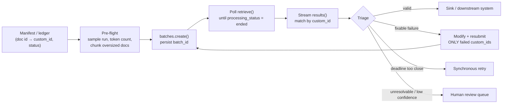
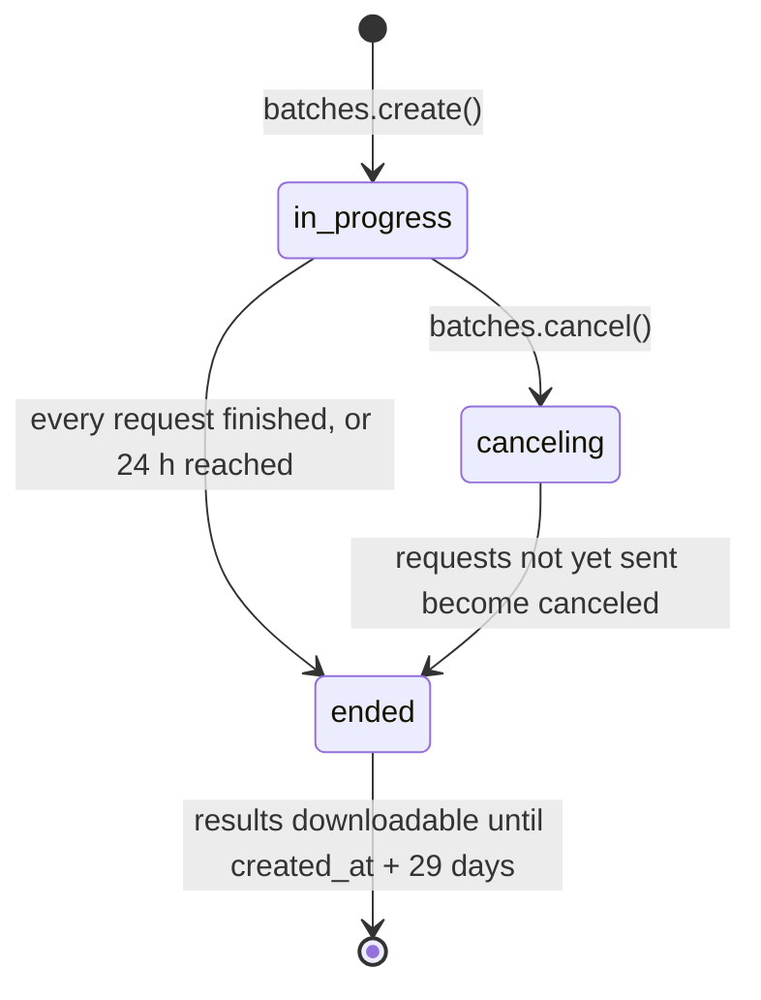
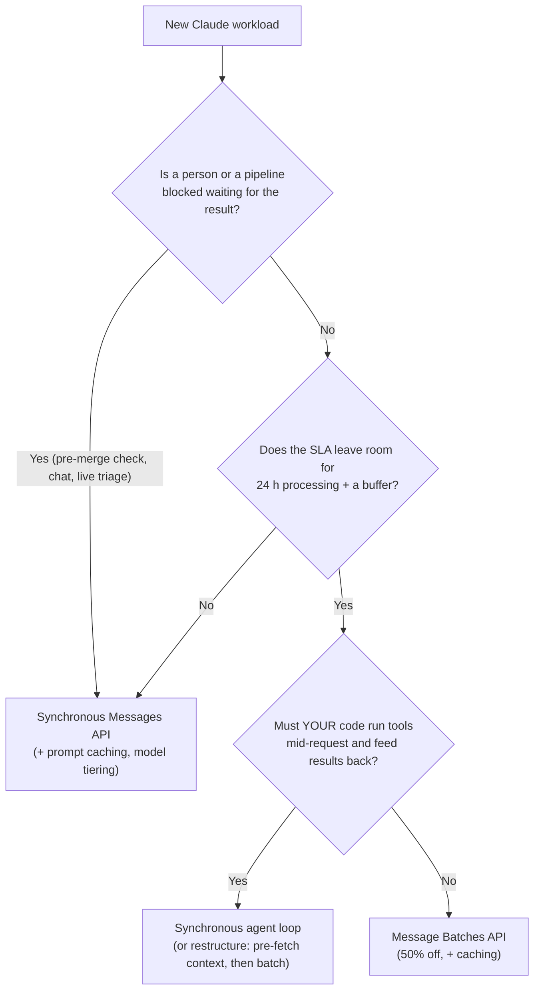
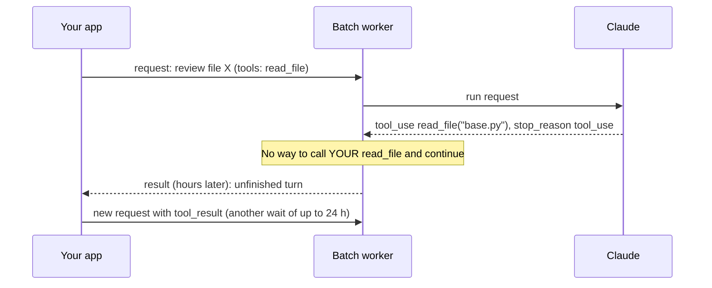
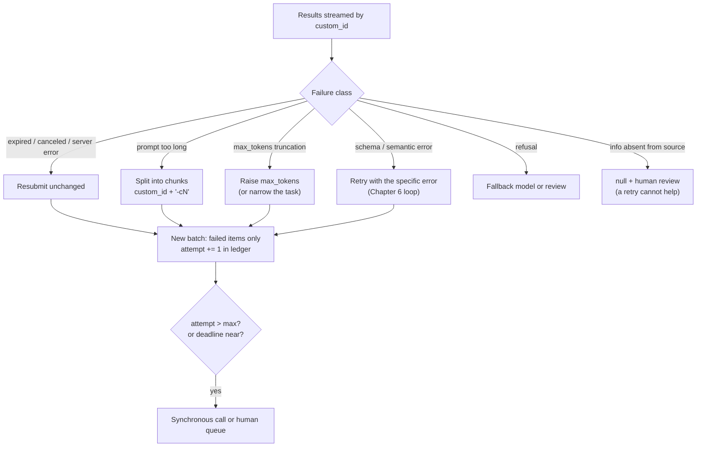

# Chapter 7 — Message Batches API

> **Exam domain(s):** Domain 4 — Prompt Engineering & Structured Output (**20%**, task 4.5 batch processing; builds on 4.4 retry loops) · Domain 5 — Context Management & Reliability (**15%**, failure handling and recovery around 5.3, review routing from 5.5) · also CCDV-F Domain 2.3 (batch API use, realtime vs batch) and Domain 5.4 (cost and token management)
> **Est. time:** 4–6 hours (reading + 2 notebooks) · **Status:** [ ] not started

## Why this matters for a solution architect

Most enterprise LLM workloads are not chats. They are piles: 40,000 contracts to extract, last night's support tickets to classify, a weekly security audit of a whole codebase, an eval suite of 5,000 cases. For this kind of work nobody is waiting on a single response. The Message Batches API cuts the price of every token in half in exchange for giving up latency guarantees. The architect's job is to know **which workloads can give up latency**, to plan the schedule so a "24 hours at most" processing window still meets the business SLA, and to build a pipeline that correlates, validates and resubmits results without double-paying or losing documents. The exam tests the decision (batch or synchronous?) and the mechanics (`custom_id`, failure handling, SLA arithmetic). A real customer also needs the cost model, the retention story and the operational runbook.

## Learning objectives

- [ ] State the core facts of the Message Batches API: 50% discount, up to 24 hours of processing with no latency SLA, 100,000 requests or 256 MB per batch, results kept for 29 days.
- [ ] Decide between the synchronous Messages API and the Batches API from a workload's latency tolerance, and explain why a blocking pre-merge check must stay synchronous.
- [ ] Explain what cannot happen inside a batch request (your code cannot execute client tools mid-request), what can (server tools, pre-built multi-turn histories), and which parameters are rejected.
- [ ] Design `custom_id` values that survive out-of-order results, retries, chunking and audits.
- [ ] Track a batch through `in_progress` → `canceling` → `ended`, stream its results, and handle the four result types, plus "succeeded but unusable" outputs.
- [ ] Resubmit **only** the failed items, with the right modification for each failure (chunk oversized documents, raise `max_tokens`, fix the request, route refusals).
- [ ] Refine prompts on a sample before a large run, and pre-flight check request shape and size.
- [ ] Calculate a submission cadence that meets an SLA (for example, 4-hour windows for a 30-hour SLA).
- [ ] Build a cost model that stacks the batch discount with prompt caching and model choice.
- [ ] Know the operational limits: batch rate limits, workspace scoping, retention, ZDR and HIPAA eligibility, extended output (beta) and cloud-platform availability.

## Prerequisites

- [00 — Prerequisites](../../00-prerequisites/README.md): Python environment, `.env` with `ANTHROPIC_API_KEY`.
- [Chapter 1 — Claude API Fundamentals](../01-claude-api-fundamentals/README.md): request shape, `stop_reason`, token counting and usage fields.
- [Chapter 2 — Tool Use](../02-tool-use/README.md): client tools vs server tools, `pause_turn`, structured outputs (`output_config.format`).
- [Chapter 6 — Prompt Engineering](../06-prompt-engineering/README.md): validation and retry-with-feedback, and when a retry cannot help.

Shared setup used by every snippet below:

```python
import os
from dotenv import load_dotenv
import anthropic
from anthropic.types.message_create_params import MessageCreateParamsNonStreaming
from anthropic.types.messages.batch_create_params import Request

load_dotenv()                                        # loads ANTHROPIC_API_KEY from .env
client = anthropic.Anthropic()                       # never hardcode the key
MODEL = os.getenv("CLAUDE_MODEL", "claude-sonnet-5-5")
```

> **Note: changed since the guide.** The guide's Chapter 7 is accurate on the four exam facts (50% savings, up to 24 h, `custom_id`, no mid-request tool round trips). The current platform adds detail the guide does not mention:
> 1. **Hard limits and timing are documented.** A batch holds at most 100,000 requests or 256 MB, whichever comes first. Most batches finish in **under one hour**, but 24 hours is the ceiling, and requests that have not run by then **expire**.
> 2. **Tool use is allowed in batches, including server tools.** Web search, web fetch, code execution, MCP connector, advisor and tool search all run their server-side loop inside a batch request. What a batch still cannot do is pause, let *your* code run a client tool, and continue (see 7.3).
> 3. **Three parameters are rejected:** `stream: true`, `speed` (fast mode) and `max_tokens: 0` (cache pre-warming). The beta `fallbacks` parameter (server-side refusal fallback) also fails, as a per-item `errored` result.
> 4. **Extended output (beta)** raises `max_tokens` to 300,000 on batches only (7.10).
> 5. **Refusals arrive as `succeeded`** results with `stop_reason: "refusal"`, so "succeeded" does not mean "usable" (7.6).
> 6. The guide's snippet uses `claude-sonnet-4-6`. This repo uses `claude-sonnet-5-5` (batch price $1 / $5 per million input / output tokens).
> 7. The guide links `build-with-claude/message-batches`; that URL now resolves to the **Batch processing** page (`build-with-claude/batch-processing`), which is the one linked below.
> 8. **Availability and compliance:** the batch endpoint is not available on Amazon Bedrock, Google Cloud or Microsoft Foundry, and batches are neither ZDR- nor HIPAA-eligible (7.11).

---

## Concepts

The whole chapter in one picture: a batch is a long-running job with one input list and one result file, and everything interesting happens in the code you wrap around it.



### 7.1 What the Message Batches API is

The Message Batches API accepts a list of ordinary Messages API requests, processes them **asynchronously and independently**, and gives you one result file when the whole batch has finished. Each request is a pair: a `custom_id` you choose and a `params` object containing exactly what you would pass to `client.messages.create()`.

| Property | Value (verified against current docs) |
|---|---|
| Price | **50% of standard prices** for all usage: input, output and special tokens (cache writes and reads included) |
| Processing time | Most batches finish in under 1 hour. **Up to 24 hours. No latency SLA.** |
| Expiry | Requests not processed within 24 hours of creation come back as `expired` (not billed) |
| Size limit per batch | **100,000 requests or 256 MB**, whichever is reached first (over 256 MB returns `413 request_too_large`) |
| Correlation | `custom_id`, 1–64 characters, `^[a-zA-Z0-9_-]{1,64}$`, unique within the batch |
| Result order | **Not guaranteed.** Match by `custom_id`, never by position |
| Result availability | When every request has finished, or after 24 hours, whichever comes first |
| Result retention | **29 days after `created_at`** (not after `ended_at`). After that the batch is still visible, but its results cannot be downloaded |
| Scope | The Workspace the batch was created in |
| Models | All active models |
| Mutability | None. You cannot edit a submitted batch; cancel it and submit a new one |

The endpoints, and their Python SDK methods:

| Operation | HTTP | Python SDK |
|---|---|---|
| Create | `POST /v1/messages/batches` | `client.messages.batches.create(requests=[...])` |
| Retrieve status | `GET /v1/messages/batches/{id}` | `client.messages.batches.retrieve(id)` |
| List (paginated) | `GET /v1/messages/batches` | `client.messages.batches.list(limit=20)` (auto-paginates) |
| Results (`.jsonl` stream) | `GET /v1/messages/batches/{id}/results` | `client.messages.batches.results(id)` |
| Cancel | `POST /v1/messages/batches/{id}/cancel` | `client.messages.batches.cancel(id)` |
| Delete | `DELETE /v1/messages/batches/{id}` | `client.messages.batches.delete(id)` (only after processing has ended; cancel first if needed) |

Creating a batch:

```python
docs = {"inv-00001": "Invoice text ...", "inv-00002": "Invoice text ..."}

batch = client.messages.batches.create(
    requests=[
        Request(
            custom_id=doc_id,
            params=MessageCreateParamsNonStreaming(
                model=MODEL,
                max_tokens=1024,
                system="Extract the invoice fields as JSON.",
                messages=[{"role": "user", "content": text}],
            ),
        )
        for doc_id, text in docs.items()
    ]
)
print(batch.id, batch.processing_status)   # msgbatch_..., "in_progress"
```

The returned `MessageBatch` object carries the fields you will build the pipeline around:

| Field | Meaning |
|---|---|
| `id` | `msgbatch_...`. **Persist it immediately** (see 7.5) |
| `processing_status` | `in_progress` → (`canceling`) → `ended` |
| `request_counts` | `processing`, `succeeded`, `errored`, `canceled`, `expired`. The last four stay **zero until the whole batch ends** |
| `created_at`, `expires_at` | `expires_at` = creation + 24 h |
| `ended_at`, `results_url` | Set only once processing ends |
| `cancel_initiated_at`, `archived_at` | When cancellation started; when results became unavailable |



> **Exam trap:** "Up to 24 hours" is a **ceiling, not a promise**. There is no latency SLA. Most batches are fast, but your design must work when one takes 23 hours, and must handle requests that **expire** if demand is high.

> **Exam trap:** A failed request does not fail the batch. Each request succeeds or fails on its own, and `errored`, `canceled` and `expired` requests are **not billed**.

### 7.2 Batch vs synchronous: matching the API to latency requirements

The deciding question is not "how many requests?" but **"is anyone (a person or a pipeline stage) blocked waiting for this answer?"** If yes, use the synchronous Messages API. If the result is consumed later on a schedule, batch it.



| Workload | API | Reasoning |
|---|---|---|
| Pre-merge PR check that blocks merging | **Synchronous** | A developer is waiting. Even one hour is unacceptable, and 24 hours is possible |
| Interactive code review, chat, support agent | **Synchronous** | Real-time by definition |
| Overnight tech-debt report read next morning | **Batch** | Latency-tolerant and scheduled |
| Weekly security audit of the whole codebase | **Batch** | Flexible deadline, large volume |
| Nightly test generation for changed modules | **Batch** | Scheduled, nobody blocked |
| 10,000 non-urgent documents overnight, cost-driven | **Batch** | The textbook case (CCDV-F sample question) |
| Eval suite of 5,000 cases before a model upgrade | **Batch** | Throughput and cost matter, not latency |
| "Deep analysis" that already polls and posts to the PR later | **Batch** | It is already asynchronous |
| Real-time fraud flag on a payment | **Synchronous** | Blocking decision |

> **Exam trap:** "Move *both* workflows to batch and fall back to synchronous if a batch takes too long" sounds clever but is wrong for a blocking check: the developer still waits for the timeout before the fallback starts, and you pay for both paths. Keep blocking work synchronous and batch only latency-tolerant work.

> **Exam trap:** "Keep both workflows synchronous to avoid result-ordering problems" is wrong too. Ordering is solved by `custom_id`, so it is never a reason to avoid batches.

**Synchronous cost levers still exist.** When a workload must stay synchronous, cut its cost with prompt caching for the stable prefix, a smaller model for simple steps (Haiku 4.5), lower `effort`, and tight `max_tokens`. Batching is one lever among several, not the only one.

> **Exam trap (vocabulary):** Three things share the word "batch" and are not the Message Batches API: (1) Claude Code has **no `--batch` flag** (non-interactive CI runs use `claude -p`, see [Chapter 5](../05-claude-code/README.md)); (2) the "**batch tool**" taught in Anthropic Academy's tool-use lessons is a tool-design pattern (one tool that accepts a list of calls so Claude can request several operations at once) and runs synchronously; (3) "batching findings and returning them to the coordinator at the end" in multi-agent questions is about orchestration, not this API.

### 7.3 What can and cannot be batched

Almost anything you can send to the Messages API can go into a batch, and requests of different kinds can be mixed in one batch:

- Vision and PDF documents. A `file_id` source from the Files API is ordinary Messages content, so it can sit in a batch request's `params` and keeps large documents out of the 256 MB request body. The Files API is generally available (no beta header), but the batch guide does not mention `file_id` sources by name, so dry-run one such request first (7.7). Uploaded files are workspace-scoped (use the same Workspace as the batch) and, like batches, not ZDR-eligible.
- System prompts and **multi-turn conversations you construct in advance** (a list of prior `user`/`assistant` turns)
- Thinking (adaptive thinking on the 5.x models; extended thinking on Haiku 4.5) and the `effort` setting
- Structured outputs (`output_config.format` with a JSON schema)
- Tool definitions, including **all server tools** (web search, web fetch, code execution, MCP connector, advisor, tool search)
- Prompt caching, and most beta features

Rejected parameters (a validation error):

| Parameter | Why it is rejected |
|---|---|
| `stream: true` | Results arrive as one file, not as a stream |
| `speed` (fast mode) | Fast mode tunes synchronous latency, which batches do not have |
| `max_tokens: 0` (cache pre-warming) | A cache entry written during batch processing would likely expire before the follow-up runs |
| `fallbacks` (beta server-side refusal fallback) | Not supported on batches. The item comes back `errored` |

**When does the rejection surface?** For `fallbacks` the docs say it explicitly: a per-item `errored` result. For the other three they only say "a validation error", without saying whether `create()` fails at once or the item comes back `errored` when the batch ends. The docs also say that each request's `params` are validated **asynchronously** and reported when the whole batch has ended (7.7). So do not count on a fast failure: lint these parameters out of every request before you submit (the practice notebook's param linter does this). The Python SDK helps a little here, because `MessageCreateParamsNonStreaming` types `stream` as `False` only, so a type checker flags `stream=True`.

**The tool-calling limitation, precisely.** Each batch request produces exactly one response, and there is no open connection back to your application. If Claude decides to call a **client tool** (a function *your* code executes, such as `read_file` or `get_customer`), the request simply ends with `stop_reason: "tool_use"`. Nothing in the batch can run your function and continue the conversation. You would need a *new* request (another batch, with another wait of up to 24 hours, or a synchronous call) for every round trip.



Server tools are different: Anthropic executes them, so their loop runs **inside** the batch worker. Because no connection is held open, the batch loop allows **more iterations per turn** than a synchronous request. If it still hits the limit, the result has `stop_reason: "pause_turn"`, and you continue by sending the paused assistant content back in a follow-up request (batch or synchronous). The batch worker also throttles `web_search` per organization and retries throttled calls for you, so very large web-search batches simply take longer.

> **Exam trap:** For an iterative review that fetches related files through a client tool, the primary limitation of batching is **"the asynchronous model cannot execute tools mid-request and return results for Claude to continue"**. It is *not* "batches don't support tool definitions" (they do), *not* "no correlation IDs" (`custom_id` exists), and *not* only latency. The fix is either to keep that workflow synchronous, or to restructure it: gather the context deterministically first (imports, base classes, tests), put it in the prompt, and then batch a single-turn analysis.

### 7.4 Designing `custom_id`

`custom_id` is the only link between a result and the thing it was about. Results come back in any order, so treat it as a primary key.

**Rules from the API:** 1–64 characters, letters, digits, `-` and `_` only, unique within a batch.

**Design rules from practice:**

| Do | Avoid | Why |
|---|---|---|
| Derive it deterministically from your own record key (`inv-2026-000417`) | The position in the request list (`req-17`) | Results are unordered, and the list changes on resubmission |
| Keep a ledger: `custom_id → source path, content hash, attempt, batch_id, status` | Encoding everything into the ID | 64 characters run out fast, and the ledger is your audit trail |
| Add a chunk suffix when you split a document (`inv-2026-000417-c2`) | Reusing the parent ID for chunks | Chunk results must be re-assembled per parent |
| Hash long natural keys (`sha256(key)[:16]`) and store the original in the ledger | Raw file paths or emails | Paths contain illegal characters, and IDs are retained for 29 days and visible in the Console, so keep PII out |
| Keep the same ID across retry batches (track the attempt in the ledger) | A new random ID per attempt | One logical item = one key, which makes deduplication and reporting trivial |

```python
import hashlib, re

CUSTOM_ID_RE = re.compile(r"^[a-zA-Z0-9_-]{1,64}$")

def make_custom_id(doc_key: str, chunk: int | None = None) -> str:
    """Stable, legal, PII-free custom_id for a document (and optional chunk)."""
    base = re.sub(r"[^a-zA-Z0-9_-]", "-", doc_key)
    if len(base) > 48 or base != doc_key:          # long or contained illegal characters
        base = "d-" + hashlib.sha256(doc_key.encode()).hexdigest()[:20]
    cid = base if chunk is None else f"{base}-c{chunk}"
    assert CUSTOM_ID_RE.match(cid), cid
    return cid
```

> **Exam trap:** `custom_id` is what lets you (1) link each result to its source document, (2) find exactly which documents failed, and (3) resubmit only those without reprocessing the successes. Any answer that resubmits the whole batch, or re-runs "the last N requests", ignores it.

### 7.5 Tracking a batch: polling, streaming results, cancel and delete

**Polling.** The documented way to learn that a batch has finished is polling (or watching it in the Console). Poll `retrieve()` until `processing_status == "ended"`. The docs' example polls every 60 seconds. For long batches, back off (for example 30 s doubling to 10 min), because status calls count against the batch API's requests-per-minute limit.

**Persist the batch ID before you do anything else.** If your orchestrator crashes after `create()` and you did not save the ID, a naive restart submits the same work again and you pay twice. Save `batch_id` with the list of `custom_id`s it contains, and on restart resume polling instead. If an ID was lost, `batches.list()` shows every batch in the workspace.

```python
import json, pathlib, time

STATE = pathlib.Path("batch_state.json")

def submit_once(requests: list[Request]) -> str:
    """Crash-safe submit: never creates the same batch twice."""
    if STATE.exists():
        return json.loads(STATE.read_text())["batch_id"]
    batch = client.messages.batches.create(requests=requests)
    STATE.write_text(json.dumps({
        "batch_id": batch.id,
        "created_at": batch.created_at.isoformat(),
        "custom_ids": [r["custom_id"] for r in requests],
    }))
    return batch.id

def wait_until_ended(batch_id: str, first_delay: float = 30, max_delay: float = 600):
    delay = first_delay
    while True:
        batch = client.messages.batches.retrieve(batch_id)
        if batch.processing_status == "ended":
            return batch                      # request_counts are now final
        time.sleep(delay)
        delay = min(delay * 2, max_delay)
```

**Streaming results.** When the batch ends, `results_url` points to a `.jsonl` file with one line per request. Do not download it all into memory. The SDK's `client.messages.batches.results(batch_id)` streams it and yields one typed `MessageBatchIndividualResponse` (`custom_id` + `result`) at a time. You can process each result as it arrives, write it to your sink, and update the ledger. Under the hood the SDK first calls `retrieve()` to read `results_url`. While the batch is still running that field is `null`, so `results()` raises `anthropic.AnthropicError` ("No `results_url` for the given batch; Has it finished processing?") instead of returning partial results. Always wait for `ended` first.

**Cancel.** `cancel()` moves the batch to `canceling`. Requests already processed keep their results; requests not yet sent become `canceled` (not billed). The batch then ends normally, so poll until `ended` and collect the partial results. Cancellation may not take effect immediately.

**Delete.** You can delete a batch (and its stored data) once processing has ended. To delete an in-progress batch, cancel it first.

> **Exam trap:** While a batch is `in_progress`, `request_counts.succeeded` stays **0** even if most requests are done, because the four outcome counters are only filled in when the whole batch ends. "Zero succeeded after 40 minutes" is not a failure signal.

### 7.6 Result types and resubmitting only the failures

Every request ends in exactly one of four result types:

| `result.type` | What happened | Billed? | Typical action |
|---|---|---|---|
| `succeeded` | A message was created (`result.message`) | Yes | **Still check it** (below) |
| `errored` | No message. `result.error` holds the standard error shape | No | `invalid_request_error`: fix the request before resending. Server-side errors (`api_error`, `overloaded_error`): resend as is |
| `canceled` | You canceled the batch before this request ran | No | Resubmit if still needed |
| `expired` | The 24-hour window ran out before this request ran | No | Resubmit as is, or synchronously if the deadline is close |

**"Succeeded" is not the same as "usable".** A succeeded result is a normal `Message`, and it can still be wrong for your pipeline:

| Situation inside a `succeeded` result | Detect with | Action |
|---|---|---|
| Refused | `stop_reason == "refusal"` (or `stop_details.type == "refusal"`) | Route to a fallback model (a new batch or a direct call) or to review. Re-sending to the same model usually earns another refusal |
| Truncated | `stop_reason == "max_tokens"` | Resubmit with a higher `max_tokens`, or split the input |
| Filled the context window | `stop_reason == "model_context_window_exceeded"` | Treat it as truncated: shorten or chunk the input, or narrow the task |
| Hit one of your stop sequences | `stop_reason == "stop_sequence"` | Expected only if you set `stop_sequences`; otherwise investigate |
| Unfinished server-tool turn | `stop_reason == "pause_turn"` | Continue in a follow-up request with the returned content |
| Asked for a client tool | `stop_reason == "tool_use"` | Redesign (see 7.3); a batch cannot finish this |
| Schema-invalid output | Pydantic / JSON Schema validation fails | Use structured outputs to prevent it; otherwise resubmit with the validation error ([Chapter 6](../06-prompt-engineering/README.md)) |
| Semantically wrong (totals don't add up) | Your own checks | Retry with specific feedback if the source has the answer; human review if it does not |

**Refusals in batches, in detail.** A refusal is not an error (synchronously it is an HTTP 200; in a batch it is a `succeeded` result), so monitoring built on error rates never sees it: count refusals as their own metric. Branch on `stop_reason` (or `stop_details.type`), not on the text, because `stop_details.category` and `stop_details.explanation` can be `null`. Server-side fallback (the beta `fallbacks` parameter) is not available in batches, and batch refusals never carry a `fallback_credit_token`. To retry refused items: collect them by `custom_id`, strip Claude Fable 5.1 / Fable 5 thinking blocks from any multi-turn history, and resubmit them on a fallback model, either as a new batch or as direct requests.

A triage function that sorts every result into a bucket:

```python
from pydantic import BaseModel, ValidationError

class Invoice(BaseModel):
    vendor: str
    invoice_number: str | None
    total: float | None

def triage(batch_id: str) -> dict[str, list]:
    buckets = {"ok": [], "retry_as_is": [], "fix_then_retry": [], "fallback_model": [], "human": []}
    for item in client.messages.batches.results(batch_id):
        cid, r = item.custom_id, item.result
        if r.type == "succeeded":
            msg = r.message
            if msg.stop_reason == "refusal":
                buckets["fallback_model"].append(cid)
            elif msg.stop_reason == "max_tokens":
                buckets["fix_then_retry"].append((cid, "truncated: raise max_tokens"))
            elif msg.stop_reason == "model_context_window_exceeded":
                buckets["fix_then_retry"].append((cid, "context window full: chunk the input"))
            elif msg.stop_reason != "end_turn":           # tool_use, pause_turn, stop_sequence
                buckets["human"].append((cid, f"unexpected stop_reason {msg.stop_reason}"))
            else:
                text = "".join(b.text for b in msg.content if b.type == "text")
                try:
                    buckets["ok"].append((cid, Invoice.model_validate_json(text)))
                except ValidationError as e:
                    buckets["fix_then_retry"].append((cid, f"schema: {e.errors()[0]['msg']}"))
        elif r.type == "errored":
            err = r.error.error                       # ErrorResponse -> typed error object
            if err.type == "invalid_request_error":   # e.g. "prompt is too long"
                buckets["fix_then_retry"].append((cid, err.message))
            else:
                buckets["retry_as_is"].append((cid, err.type))
        else:                                         # "canceled" or "expired": never ran, not billed
            buckets["retry_as_is"].append((cid, r.type))
    return buckets
```

**Resubmission with modifications.** The exam's canonical example: 100 documents, 95 succeed, 5 fail because they exceed the context window. You look up the 5 by `custom_id`, change the strategy for those 5 (split each document into chunks with IDs such as `inv-000417-c0`, `-c1`), and submit a **new batch containing only those requests**. The 95 are never reprocessed.



Cap the attempts (2–3 is typical), and remember that each batch-based retry can cost another 24 hours of wall-clock time (7.8).

### 7.7 Pre-flight: refine on a sample before the big run

Validation of each request's `params` happens **asynchronously**: a malformed request is only reported as `errored` when the entire batch has ended, possibly hours later. A wrong prompt is worse, because it "succeeds" and you pay for 50,000 bad extractions. So before a large run:

1. **Dry-run the request shape** with one synchronous `client.messages.create(**params)` call (or a tiny batch). This catches invalid parameters in seconds.
2. **Refine the prompt on a representative sample** (20–100 documents covering every document type), measure first-pass success (schema-valid, semantically valid, matches labels), and iterate until it is high. Few-shot examples and explicit criteria from [Chapter 6](../06-prompt-engineering/README.md) are the usual fixes.
3. **Count tokens** with `client.messages.count_tokens(...)` (free, rate-limited) to find documents that will not fit in the context window, and chunk them **before** submission instead of after a failed run.
4. **Estimate cost** from the sample's `usage` (7.9) and get sign-off before spending at scale.

Why it pays: a prompt with an 85% first-pass rate on 50,000 documents leaves 7,500 resubmissions, each adding another batch cycle of up to 24 hours. Raising first-pass success to 98% on a 50-document sample costs cents and removes most of that work.

> **Exam trap:** When asked how to "maximize first-pass success and reduce resubmission cost" for a large batch, the answer is **prompt refinement on a sample set first**. It is not "submit everything and fix failures afterwards", and not "use a bigger model for the whole batch".

### 7.8 SLA planning and submission cadence

Batch processing time has a known **upper bound** (24 h) but no lower-bound guarantee, so you plan for the worst case. For work that arrives continuously, the worst-case age of a result is:

```text
worst-case latency = W (longest wait before an item is submitted, i.e. the window length)
                   + P (batch processing, plan for 24 h)
                   + B (buffer: polling lag, validation, retries of failures, downstream load)
```

To meet an SLA, choose a window `W ≤ SLA − P − B`.

**The exam example: 30-hour SLA, 24-hour batch processing.** 30 − 24 leaves 6 hours of slack in total. If you submitted every 6 hours, a document arriving just after a submission would wait 6 h, then up to 24 h of processing, and reach exactly 30 h with **zero** time for validation or retries. Submitting every **4 hours** keeps a 2-hour buffer: 4 + 24 + 2 = 30.

```mermaid
gantt
    title Worst case for a document that just missed a submission (30 h SLA, 4 h windows)
    dateFormat HH
    axisFormat %H h
    section Document
    Waits for next submission (W = 4 h)     :w, 00, 4h
    Batch processing, worst case (P = 24 h) :p, after w, 24h
    Validate, retry failures synchronously (B = 2 h) :b, after p, 2h
```



Planning rules that follow:

| Rule | Reason |
|---|---|
| Size `W` from the SLA, not from cost alone | Longer windows mean bigger batches but older results |
| For a fixed deadline (report due Monday 08:00), submit no later than `deadline − 24 h − B` | Same arithmetic, with `W = 0` |
| Retries that must land inside the SLA go **synchronous** | A second batch cycle adds up to another 24 h; with a 2 h buffer it cannot fit |
| If you want batch-priced retries, the SLA must cover two cycles: `W + 24 + 24 + B` | Otherwise retries break the SLA |
| Plan for `expired` items | Under heavy demand some requests may not run within 24 h at all |
| Split very large jobs into several batches | Manageability, and staying inside queue limits (7.11) |

> **Exam trap:** "Most batches finish within an hour, so 1-hour windows with a 2-hour SLA are fine" fails the SLA whenever the batch is slow. Guarantees must be computed from the 24-hour bound.

### 7.9 Cost modeling: batch discount, prompt caching and model choice

Batch prices are exactly half of standard prices (per million tokens, Claude API, October 2026):

| Model | Standard input / output | **Batch input / output** | Cache read, batch | Min. cacheable prefix |
|---|---|---|---|---|
| Claude Sonnet 5.5 (`claude-sonnet-5-5`) | $2 / $10 | **$1 / $5** | $0.10 | 512 tokens |
| Claude Haiku 4.5 (`claude-haiku-4-5`) | $1 / $5 | **$0.50 / $2.50** | $0.05 | 4,096 tokens |
| Claude Opus 5.5 (`claude-opus-5-5`) | $4 / $20 | **$2 / $10** | $0.10 (reads are 0.05× base input on Opus 5.5) | 512 tokens |
| Claude Fable 5.1 (`claude-fable-5-1`) | $10 / $50 | **$5 / $25** | $0.125 (reads are 0.025× base input on Fable 5.1) | 512 tokens |

**Prompt caching stacks with the batch discount.** Caching multipliers (5-minute write 1.25×, 1-hour write 2×, read 0.1× base input on most models, 0.05× on Opus 5.5 and 0.025× on Fable 5.1) apply on top of the 50% batch price. Other pricing modifiers stack too: on Claude 4.6 and later models, `inference_geo: "us"` (US-only inference) adds 1.1× on every token category, batch included. Because batch requests run concurrently and in any order, cache hits are **best-effort**: Anthropic reports typical hit rates between 30% and 98%. To push the rate up:

1. Put the **identical** shared prefix (system prompt, schema, few-shot examples, shared reference document) at the start of every request, with an identical **explicit** `cache_control` breakpoint on the last shared block. Do not rely on top-level automatic caching here: it puts the breakpoint on the last cacheable block, which in a batch request is the document that changes every time, so each entry it writes ends in a unique document and the other requests never hit it.
2. Keep a steady stream of requests so 5-minute entries do not expire.
3. Prefer the **1-hour TTL** for batches, because batches commonly take between 5 minutes and an hour. The documented cost-efficient recipe: submit a batch containing **one** request with the shared prefix and a 1-hour `cache_control` block, wait for it to finish (this writes the cache), then submit the rest.
4. Check the minimum: a prefix shorter than the model's minimum cacheable length is silently not cached (no error).
5. Keep everything rendered into the prefix identical too: the same thinking configuration and `output_config.effort` in the warm-up request and in the rest of the batch, or the warm-up writes an entry the real requests never hit.

> **Model lifecycle check.** Claude Haiku 4.5 (`claude-haiku-4-5-20251001`) is listed as active with retirement "not sooner than October 15, 2026". Before you build a long-lived pipeline on any model, check [Model deprecations](https://platform.claude.com/docs/en/about-claude/model-deprecations) and keep the model ID in configuration (`CLAUDE_MODEL`), not in code.

```python
SHARED = [
    {"type": "text", "text": "You extract invoice fields. Rules: ..."},
    {"type": "text", "text": FEW_SHOT_EXAMPLES,            # identical in every request
     "cache_control": {"type": "ephemeral", "ttl": "1h"}},
]

def extraction_request(cid: str, doc: str) -> Request:
    return Request(custom_id=cid, params=MessageCreateParamsNonStreaming(
        model=MODEL, max_tokens=1024, system=SHARED,
        messages=[{"role": "user", "content": f"<document>\n{doc}\n</document>"}],
    ))
```

**Worked example (illustrative).** 10,000 documents. Each request has a 3,000-token shared prefix plus a 2,000-token document (5,000 input tokens) and produces 500 output tokens.

| Option | Input cost | Output cost | Total |
|---|---|---|---|
| Sonnet 5.5, synchronous, no caching | 50M × $2 = $100 | 5M × $10 = $50 | **$150** |
| Sonnet 5.5, batch, no caching | 50M × $1 = $50 | 5M × $5 = $25 | **$75** |
| Sonnet 5.5, batch + 5-min caching at a 70% hit rate | prefix: 21M read × $0.10 + 9M write × $1.25 = $13.35; documents: 20M × $1 = $20 | $25 | **≈ $58** |
| Haiku 4.5, batch (if the sample run shows quality is good enough) | 50M × $0.50 = $25 (the 3,000-token prefix is below Haiku's 4,096 minimum, so nothing is cached) | 5M × $2.50 = $12.50 | **$37.50** |

Two lessons: batch plus caching plus the right model tier compound, and the "obvious" saving (caching on Haiku) can silently not exist. Always measure with `usage` fields. (With the recommended 1-hour TTL the 9M write tokens cost 9M × $2 = $18 instead of $11.25, so the 1-hour TTL pays off only if it lifts the hit rate enough; that is the trade the pre-warm recipe is designed to win.)

> **Exam scope.** The CCAR-F exam guide lists "rate limiting, quotas, or API pricing calculations" as **out of scope** (`CCAR-F/APPX/OUT/11`). The exam tests the 50% discount, the 24-hour window and the batch-vs-sync decision, not this arithmetic. The cost tables here and the rate-limit table in 7.11 are for the job (and for the CCDV-F cost-modeling items), not for CCAR-F questions.

**Track actual spend from the results.** Every succeeded result carries `message.usage` (`input_tokens`, `output_tokens`, `cache_creation_input_tokens`, `cache_read_input_tokens`). Sum them per batch, multiply by the batch prices, and report the cost per document. Do not rely on the estimate. For output-heavy work, a lower `effort` (set in `output_config`) and a tight `max_tokens` are the other two levers.

> **Exam trap:** Caching and batching are **complementary, not alternatives**. "Use prompt caching instead of batches" (or the reverse) is wrong when the workload is latency-tolerant and shares a prefix: use both.

### 7.10 Extended output (beta) on batches

The beta header **`output-300k-2026-03-24`** raises the `max_tokens` cap to **300,000** for batch requests on Claude Opus 5.5, Opus 5, Opus 4.8, Opus 4.7, Opus 4.6, Sonnet 5.5, Sonnet 5 and Sonnet 4.6. The synchronous limit stays at 128K. It is meant for book-length drafts, very long documentation, exhaustive extraction over huge inputs, and large code scaffolds. Standard batch pricing applies.

```python
from anthropic.types.beta.message_create_params import MessageCreateParamsNonStreaming as BetaParams
from anthropic.types.beta.messages.batch_create_params import Request as BetaRequest

batch = client.beta.messages.batches.create(
    betas=["output-300k-2026-03-24"],
    requests=[BetaRequest(custom_id="api-guide-001", params=BetaParams(
        model=MODEL, max_tokens=300_000,
        messages=[{"role": "user", "content": "Write the complete developer guide for ..."}],
    ))],
)
```

Planning notes: a single 300K-token generation can take **over an hour**, so leave room inside the 24-hour window. Extended output works only on the Message Batches API, on the Claude API and Claude Platform on AWS. It is not currently available on Amazon Bedrock, Google Cloud or Microsoft Foundry.

### 7.11 Operations: rate limits, retention, privacy and platforms

**Rate limits.** The Batches API has its own limits, shared across all models: requests per minute to the batch endpoints (create, retrieve, list, results...), and a cap on how many batch requests can wait in the processing queue at once. Using batches does **not** consume your Messages API rate limits.

| Usage tier | Batch API RPM | Batch requests in processing queue | Requests per batch |
|---|---|---|---|
| Start | 1,000 | 200,000 | 100,000 |
| Build | 2,000 | 300,000 | 100,000 |
| Scale | 4,000 | 500,000 | 100,000 |

(Custom tiers are available through sales.) Under high demand processing may slow down, and more requests may expire. Because of the concurrency, a batch can also go slightly **over a workspace's spend limit**, so set limits with some headroom.

**Retention and privacy.**

- Batches and their results are isolated to the **Workspace** that created them: only API requests in that Workspace (or Console users allowed to view its batches) can see them. A key that belongs to one Workspace needs nothing extra. A credential that can act on several Workspaces selects one per call with the `anthropic-workspace-id` header, which every SDK batch method exposes as `workspace_id=` (for example `client.messages.batches.retrieve(batch_id, workspace_id="wrkspc_...")`). Persist the Workspace ID next to the batch ID in your manifest.
- Inputs and outputs are stored for up to **29 days after creation**. Delete a batch earlier with `DELETE /v1/messages/batches/{id}` (cancel first if it is still running).
- The Batches API is **not eligible for Zero Data Retention (ZDR)**, because asynchronous processing needs server-side storage. Under a ZDR arrangement the API does **not** block batch requests: using batches is a choice to step outside ZDR for that data. So for a ZDR customer, sensitive workloads either stay on the synchronous API or the customer explicitly accepts the 29-day storage (and you delete promptly). Deleting early reduces exposure but does not make the workload ZDR-eligible.
- Batches are also **not HIPAA-eligible**. Under HIPAA readiness the API *does* block features marked ineligible and returns a `400` error, so PHI workloads stay on the synchronous Messages API.
- Console download of batch results can be disabled per organization or per workspace.

**Cloud platforms.** The Message Batches API (`/v1/messages/batches`) is listed as **not supported** on Claude in Amazon Bedrock, on Google Cloud (Vertex AI) and on Claude in Microsoft Foundry. It is available on the Claude API and on Claude Platform on AWS (where extended output, 7.10, also works). Elsewhere, the options differ by cloud (checked against each provider's docs, October 2026):

| Platform | Batch option for Claude | What to check |
|---|---|---|
| Amazon Bedrock | Bedrock **batch inference** (a job over JSONL input in S3) | Model and Region support is listed per model. AWS's table does not list every current Claude model (in October 2026 it stopped at Claude Opus 5 and Sonnet 4.6), so confirm your model is there |
| Google Cloud (Vertex AI) | Vertex AI **batch predictions** for Claude (input from Cloud Storage or BigQuery) | The supported-model list, quotas and pricing on Google's Claude batch page |
| Microsoft Foundry | **None documented.** Neither Anthropic's Foundry page nor Microsoft's Claude-on-Foundry guide describes a batch option for Claude | Plan synchronous calls behind your own queue and rate limiter, or run the batch work on the Claude API if data residency and procurement allow |

Each provider's service has its own input format, limits, retention and pricing, so do not assume the numbers in this chapter carry over. Design the pipeline so the batch client is behind an interface (the practice notebook's `BatchBackend` protocol, exercised with the offline `FakeBatchAPI`), so you can swap the backend.

**Cross-vendor note.** OpenAI's Batch API makes the same core trade (50% discount, 24-hour completion window, a `custom_id` per line), but you upload a `.jsonl` input file first and pass its file ID. The architecture in this chapter carries over unchanged.

### 7.12 Reliability around a batch pipeline (Domain 5)

The Batches API runs requests. Reliability comes from the code around it. These are the Domain 5 habits applied to batch work:

| Reliability concern | Batch-pipeline practice | Related task |
|---|---|---|
| Crash recovery | Persist `batch_id` and the `custom_id` list at submit time (a manifest); on restart, resume polling instead of resubmitting ([Chapter 11](../11-context-management/README.md) generalizes manifests to multi-agent crash recovery) | 5.4 (state manifests) |
| No silent loss | Reconcile: every `custom_id` in the manifest must end in exactly one terminal state (accepted, human review, abandoned with reason). Alert if `results` has fewer lines than the manifest | 5.3 (never suppress errors) |
| Structured failure records | For each failure, store failure type, what was attempted (model, attempt number, chunking), partial results, and the next action, not just "failed" | 5.3 (structured error context) |
| Don't stop everything for one failure | One errored request never blocks the 99 others; process successes immediately | 5.3 |
| Distinguish "not found" from "failed" | An extraction that correctly returns `null` for an absent field is a **valid result**, not an error to retry | 4.4 / 5.3 |
| Coverage reporting | End every run with a report: 100 submitted → 95 accepted, 3 accepted after resubmission, 2 in human review | 5.3 (coverage annotations) |
| Human review | Route low-confidence fields, contradictory documents and refusals to reviewers, and sample high-confidence results by document type to measure the real error rate ([Chapter 9](../09-escalation-human-in-the-loop/README.md) goes deep) | 5.5 |
| Idempotent sinks | Write results keyed by `custom_id` (upsert), so replays and resubmissions never duplicate records | ROLE/ARCH/5 |

> **Exam trap:** An aggregate "97% of the batch succeeded" can hide a document type that fails 40% of the time. Report results **by document type and field**, not just in total, before you reduce human review.

---

## Notebooks

| Notebook | Sections covered | What you will build / run |
|---|---|---|
| [`01_practice.ipynb`](01_practice.ipynb) | 7.1–7.12: building `Request` payloads offline and checking them against the `custom_id` pattern and the 100,000-request / 256 MB limits; a batch-vs-sync classifier over a list of workloads; a param linter for what cannot be batched, plus client-tool `tool_use` vs server-tool `pause_turn` results; `FakeBatchAPI`, a real SDK client over a simulated Batches API with a virtual clock (`in_progress` → `canceling` → `ended`, `request_counts` that stay zero until the end, out-of-order JSONL results, `errored` / `expired` / `canceled` items, and `succeeded` items that are refused or truncated); crash-safe submit and polling with backoff; result triage into buckets and a failures-only resubmission plan; sample-based prompt refinement by document type; an SLA window calculator and arrival simulation; a cost model with caching and model tiers; an extended-output payload builder; ops, retention and reliability helpers; and a small, clearly marked live path (a 3-request batch on Haiku 4.5, plus a cancel demo) | **Mini-project:** a batch extraction pipeline over 100 synthetic documents: manifest → sample-chosen prompt and token check (oversized documents chunked) → submit → poll → stream results → Pydantic schema and semantic validation → resubmit **only** the failed `custom_id`s with modifications (chunking, larger `max_tokens`, validation feedback, fallback model; synchronous when the SLA has no room for another cycle) → human-review queue → coverage and cost report, run with and without pre-flight chunking to compare. It runs fully offline on the fake client by default, and the same code runs live with a flag |
| [`02_homework.ipynb`](02_homework.ipynb) | Self-test for 7.1–7.12 | 10-question exam-style quiz (hashed answer key); 6 offline coding exercises with auto-checks on real SDK result types (build a valid batch request list from document keys, choose batch vs sync per workload, triage results into accept / resubmit / fix / fallback / review buckets, compute the submission window for an SLA, estimate batch cost with caching, build the resubmission batch with only failed items and chunked oversized documents) plus one optional live exercise; an architecture scenario (nightly contract extraction for 50,000 documents with a 30-hour SLA) with a rubric; and a scorecard (pass mark 72%) |

Theory stays in this README; notebooks hold code. Run them from the repo root venv (see [../../00-prerequisites/README.md](../../00-prerequisites/README.md)).

## Architect decision cheat-sheet

| Situation | Choose | Over | Why |
|---|---|---|---|
| A developer or pipeline stage is blocked on the answer | Synchronous Messages API | Batch "with fallback" | No latency SLA on batches; the fallback still makes people wait |
| Scheduled, latency-tolerant bulk work (nightly, weekly) | Message Batches API | Synchronous loop | 50% off every token, separate rate limits |
| Workflow needs your client tools mid-reasoning | Synchronous agent loop, or pre-fetch context then batch | Batch as is | A batch cannot run your tool and continue |
| Web enrichment or analysis over many records | Batch with server tools | Client-side search tool | Server tools run their loop inside the batch |
| Correlating results | `custom_id` derived from your record key + ledger | List position | Results are unordered |
| 5 of 100 documents failed (too long) | Chunk those 5 and resubmit only them | Re-running all 100 | No duplicate cost or duplicate records |
| Large run with an untested prompt | Refine on a 20–100 document sample first | Submit, then fix | Validation is async; bad prompts "succeed" |
| 30 h SLA, 24 h processing | 4 h submission windows (2 h buffer) | 6 h windows (no buffer) | Room for validation and synchronous retries |
| Retry must land inside a tight SLA | Synchronous retry | Another batch | Another batch can add 24 h |
| Shared long prefix across the batch | Batch + prompt caching (1-hour TTL, pre-warm with a one-request batch) | Choosing one of them | Discounts stack; batch cache hits are best-effort |
| Simple, high-volume extraction | Batch on Haiku 4.5 (after a quality check) | Batch on a bigger model | Cheapest per document if quality holds |
| Need more than 128K output tokens in one turn | Batch + `output-300k-2026-03-24` beta | Synchronous, or stitching many calls | Only batches allow up to 300K |
| Customer requires Zero Data Retention or HIPAA | Synchronous API | Batches | Batches store data for up to 29 days and are neither ZDR- nor HIPAA-eligible |
| Deploying on Bedrock or Vertex AI | The cloud's own batch service (Bedrock batch inference, Vertex AI batch predictions), after checking your model is listed | `/v1/messages/batches` | The Anthropic batch endpoint is not supported there |
| Deploying on Microsoft Foundry | Synchronous calls behind your own queue, or batch work on the Claude API | Assuming a Foundry batch option | No batch option for Claude is documented on Foundry |

## Common mistakes and anti-patterns

- **Batching a blocking check** because "it's 50% cheaper", or adding a sync fallback to make a blocking batch acceptable.
- **Matching results by position.** Results come back in any order; always use `custom_id`.
- **Using list indexes, random UUIDs per attempt, file paths or emails as `custom_id`.**
- **Treating `succeeded` as done** without checking `stop_reason` (`refusal`, `max_tokens`, `pause_turn`, `tool_use`) and validating the output.
- **Resubmitting the entire batch** after a few failures, or resubmitting failures **unchanged** when the cause was the request itself (too long, invalid, truncated).
- **Retrying missing information.** If the value is not in the document, a retry produces a fabricated value; return `null` and route to review.
- **Not persisting the batch ID**, then double-submitting after a crash.
- **Reading `request_counts.succeeded == 0` during processing as a failure.**
- **Planning the SLA from the typical one-hour completion** instead of the 24-hour bound, or planning batch-based retries that cannot fit in the SLA.
- **Skipping the sample run**: discovering a prompt bug after paying for 50,000 requests.
- **Downloading the whole results file into memory** instead of streaming it, or calling `results()` before the batch has `ended` (the SDK raises because `results_url` is still `null`).
- **Monitoring only error rates.** Refusals and truncations arrive as `succeeded`; count them as their own signals.
- **Expecting cache hits on a short prefix** (below the model's minimum) or on prefixes that differ by one character between requests.
- **Sending `stream`, `speed`, `max_tokens: 0` or `fallbacks`** inside batch requests.
- **Forgetting retention**: leaving sensitive batches stored for 29 days when the customer's policy needs deletion, or promising ZDR (or HIPAA coverage) on a batch workload.
- **Counting only aggregate success** instead of success by document type and field.

## Self-check

**1.** A team runs two Claude workflows synchronously: a pre-merge check that blocks merging, and a tech-debt report generated overnight for the morning stand-up. A manager wants to move both to the Message Batches API for the 50% saving. What do you recommend?

- A) Move both to batches and poll for completion
- B) Move both to batches, with a fallback to synchronous calls if a batch takes too long
- C) Batch the overnight report only; keep the pre-merge check synchronous
- D) Keep both synchronous to avoid batch result-ordering problems

<details><summary>Answer</summary>

**C.** Batches have no latency SLA (up to 24 hours), which is fine for an overnight report and unacceptable for a blocking check. A blocks developers. B still makes developers wait for the timeout before the fallback runs, and pays for both paths. D cites a non-problem: `custom_id` handles ordering.
</details>

**2.** Your review component lets Claude request related files through a tool your application implements, then continues its analysis with those files. You consider batching it to save cost. What is the main technical obstacle?

- A) Batch requests cannot include tool definitions
- B) Batch results have no correlation IDs
- C) A batch request cannot pause for your code to execute a tool and then continue the same analysis
- D) Only the 24-hour latency; otherwise it would work unchanged

<details><summary>Answer</summary>

**C.** Each batch request produces one response with no channel back to your application, so a client-tool call just ends the request with `stop_reason: "tool_use"`. A is false (tool definitions, and even server tools, are supported). B is false (`custom_id`). D misses the functional break: each tool round trip would need a whole new request.
</details>

**3.** You batch 100 invoices. 95 succeed. 5 come back `errored` with `invalid_request_error: prompt is too long`. What is the most efficient next step?

- A) Resubmit all 100 with a larger `max_tokens`
- B) Identify the 5 by `custom_id`, split each into chunks, and submit a new batch with only those chunk requests
- C) Resubmit the 5 unchanged, because errored requests are often transient
- D) Switch the whole pipeline to synchronous calls

<details><summary>Answer</summary>

**B.** Resubmit only the failures, with the modification that fixes the cause. A reprocesses 95 successes and changes the wrong parameter (`max_tokens` is the output cap; the problem is input size). C repeats a deterministic failure (`invalid_request_error` must be fixed before resending). D gives up the discount for no reason.
</details>

**4.** Documents arrive continuously and must be processed within 30 hours of arrival. You plan around the 24-hour batch processing bound and want time to validate results and synchronously retry failures. Which submission cadence fits?

- A) One batch every 24 hours
- B) One batch every 6 hours
- C) One batch every 4 hours
- D) One batch every 12 hours, since most batches finish within an hour

<details><summary>Answer</summary>

**C.** Worst case = window + 24 h + buffer. With 4-hour windows: 4 + 24 = 28 h, leaving 2 h for validation and synchronous retries. B uses all 6 hours of slack and leaves no buffer. A and D break the SLA in the worst case; "most batches are fast" is not a guarantee.
</details>

**5.** A developer writes the extraction results to the database by zipping the results stream with the original document list. QA finds that values are attached to the wrong documents. What is the fix?

- A) Sort the results by message ID before zipping
- B) Submit smaller batches so the order is preserved
- C) Key each result by its `custom_id` and look up the source document in the ledger
- D) Poll more often so results arrive in submission order

<details><summary>Answer</summary>

**C.** Batch results are not guaranteed to be in request order, at any batch size. `custom_id` is the correlation key. A, B and D all assume an ordering the API does not provide.
</details>

**6.** A nightly batch of 20,000 requests shares a 6,000-token system prompt and few-shot block marked with `cache_control`. The cache-read share is lower than expected. Which change most improves it?

- A) Remove caching, because it does not work with batches
- B) Make the prefix byte-identical across all requests, use the 1-hour TTL, and first submit a one-request batch that writes the cache, then submit the rest
- C) Move the few-shot examples to the end of each user message
- D) Switch the batch to `stream: true` so requests run in order

<details><summary>Answer</summary>

**B.** Batch cache hits are best-effort, and this is the documented recipe for raising them. A is false: caching works with batches and the discounts stack. C moves shared content after the varying content, which destroys the shared prefix. D is rejected by the Batches API.
</details>

**7.** Before running 50,000 contracts through a new extraction prompt in a batch, the team wants to keep resubmission cost down. What should they do first?

- A) Submit all 50,000 and resubmit whatever fails
- B) Run the prompt on a representative sample, measure first-pass success by document type, refine, and dry-run the exact request shape
- C) Use the largest model for the whole batch to avoid failures
- D) Split the job into 500 batches of 100 so failures are smaller

<details><summary>Answer</summary>

**B.** Refining on a sample maximizes first-pass success before you pay at scale, and a dry run catches invalid parameters that a batch would only report hours later. A pays for every flaw 50,000 times. C costs more and does not fix prompt problems. D changes the packaging, not the success rate.
</details>

**8.** A batch ends with `request_counts.succeeded = 1000`. Your pipeline marks all 1,000 documents complete. Later, analysts find some outputs cut off mid-JSON and a few that are polite refusals. What went wrong?

- A) Nothing; succeeded results are guaranteed to be complete and valid
- B) The pipeline did not check `stop_reason` and validate each succeeded result; truncated items need a higher `max_tokens` and refusals need a fallback model or review
- C) The batch should have been canceled and resubmitted
- D) Errored results were misreported as succeeded

<details><summary>Answer</summary>

**B.** `succeeded` only means a message was created. `stop_reason: "max_tokens"` and `stop_reason: "refusal"` both arrive as succeeded results (so does `model_context_window_exceeded`), so validate every one. A is the misconception. C and D misread how result types work.
</details>

## Certification coverage

Requirement IDs come from the official exam guides and Academy course outlines (see the [Claude path overview](../README.md)). This table feeds the repo coverage matrix. **Primary** means this chapter is where the item is taught in full; **Supporting** means it is applied or introduced here and taught in full elsewhere (or is listed for context).

| Requirement ID | What it asks (short) | Where in this chapter | Depth (Primary/Supporting) |
|---|---|---|---|
| `CCAR-F/D4/4.5/K1` | Batches: 50% savings, up to 24 h, no latency SLA | 7.1, 7.8; practice 7.1, 7.8 | Primary |
| `CCAR-F/D4/4.5/K2` | Batch fits non-blocking, latency-tolerant work; not blocking pre-merge checks | 7.2; practice batch-vs-sync classifier | Primary |
| `CCAR-F/D4/4.5/K3` | No multi-turn tool calling within a single batch request | 7.3 (client tools vs server tools, `tool_use` vs `pause_turn`) | Primary |
| `CCAR-F/D4/4.5/K4` | `custom_id` for request/response correlation | 7.4, 7.6; homework Exercise 1 | Primary |
| `CCAR-F/D4/4.5/S1` | Match API to latency needs: sync for pre-merge, batch for overnight/weekly | 7.2, Self-check 1; homework Exercise 2 | Primary |
| `CCAR-F/D4/4.5/S2` | Submission frequency from SLA (4 h windows for a 30 h SLA) | 7.8, Self-check 4; practice SLA calculator; homework Exercise 4 | Primary |
| `CCAR-F/D4/4.5/S3` | Resubmit only failed documents by `custom_id`, with modifications (chunking) | 7.6, Self-check 3; homework Exercise 6 | Primary |
| `CCAR-F/D4/4.5/S4` | Prompt refinement on a sample before large batches | 7.7, Self-check 7; practice sample-refinement section | Primary |
| `CCAR-F/APPX/TECH/6` | Batches: savings, 24 h window, `custom_id`, polling, no multi-turn tool calling | 7.1, 7.3, 7.4, 7.5 | Primary |
| `CCAR-F/APPX/IN/15` | Batch appropriateness, latency tolerance, failure handling by `custom_id` | 7.2, 7.6 | Primary |
| `CCAR-F/SQ11` | Official sample: batch the overnight report only, keep the pre-merge check synchronous | 7.2, Self-check 1 | Primary |
| `CCAR-F/SQ10` | Official sample: there is no `--batch` flag in Claude Code (use `claude -p`) | 7.2 (vocabulary trap; full treatment in [Chapter 5](../05-claude-code/README.md)) | Supporting |
| `CCAR-F/EX3/4` | Exercise: 100 docs in a batch, failures by `custom_id`, resubmit with chunking, SLA calculation | 7.6, 7.8; practice mini-project (100 documents) | Primary |
| `CCAR-F/PREP/4` | Practice batch processing in a structured extraction pipeline | Practice mini-project (Pydantic validation, nullable fields, resubmission) | Supporting |
| `CCAR-F/D4/4.4/K2` | Retries cannot help when the information is absent from the source | 7.6 ("info absent from source" branch), 7.12; full treatment in [Chapter 6](../06-prompt-engineering/README.md) | Supporting |
| `CCAR-F/D4/4.4/S2` | Tell when a retry will work (format errors) and when it will not (missing info) | 7.6 triage table, 7.12 | Supporting |
| `CCAR-F/D5/5.3/K4` | Neither silently suppress errors nor stop the whole workflow on one failure | 7.12 (reconciliation; one errored request never blocks the rest) | Supporting |
| `CCAR-F/D5/5.3/S1` | Structured error context: failure type, what was attempted, partial results | 7.12 (structured failure records) | Supporting |
| `CCAR-F/D5/5.3/S4` | Coverage annotations on output | 7.12 (coverage report); practice mini-project report | Supporting |
| `CCAR-F/D5/5.4/K4` | Structured state persistence / manifests for crash recovery | 7.5 (`submit_once`), 7.12; full treatment in [Chapter 11](../11-context-management/README.md) | Supporting |
| `CCAR-F/D5/5.5/K1` | Aggregate accuracy can hide weak document types or fields | 7.12 (exam trap), practice sample refinement by document type | Supporting |
| `CCAR-F/D5/5.5/S4` | Route low-confidence or ambiguous extractions to human review | 7.12; full treatment in [Chapter 9](../09-escalation-human-in-the-loop/README.md) | Supporting |
| `CCAR-F/EX3/5` | Exercise: human review routing and accuracy by document type and field | 7.12, practice mini-project review queue; full treatment in [Chapter 9](../09-escalation-human-in-the-loop/README.md) | Supporting |
| `CCAR-F/APPX/OUT/11` | Out of scope for CCAR-F: rate limiting, quotas, pricing calculations | 7.9 (exam-scope note); taught anyway for CCDV-F and the job | Supporting |
| `CCDV-F/PURPOSE/6` | Manage model tiers, tokens, caching and batch processing for cost and latency | 7.2, 7.9 | Primary |
| `CCDV-F/D2/2.3/K9` | Batch API use | 7.1, 7.3, 7.5, 7.6; practice `FakeBatchAPI` sections | Primary |
| `CCDV-F/D2/2.3/K10` | Trade-offs between realtime and batch API selection | 7.2; homework Exercise 2 | Primary |
| `CCDV-F/SQ1` | Official sample: 10,000 overnight documents, cost-driven: Message Batches API | 7.2 (workload table) | Primary |
| `CCDV-F/D5/5.4/K1` | Token budgeting | 7.7 (`count_tokens` pre-flight), 7.9 | Supporting |
| `CCDV-F/D5/5.4/K2` | Token usage tracking | 7.9 (sum `usage` from results) | Supporting |
| `CCDV-F/D5/5.4/K3` | Cost modeling | 7.9 (worked example); homework Exercise 5 | Primary |
| `CCDV-F/D5/5.4/K4` | Prompt caching | 7.9 (caching stacked on the batch discount) | Supporting |
| `CCDV-F/D5/5.4/K5` | Cache check-pointing (breakpoints) | 7.9 (explicit `cache_control` on the last shared block) | Supporting |
| `CCDV-F/D5/5.3/K3` | Quality / latency / cost trade-offs | 7.2, 7.9 | Supporting |
| `CCDV-F/MQC/3` | Trade-offs in model selection (cost, latency, capability) | 7.9 (model-tier rows, Haiku 4.5 quality check) | Supporting |
| `CCDV-F/D2/2.4/K3` | Asynchronous programming | 7.5 (submit, persist, poll with backoff, stream results) | Supporting |
| `ACAD/claude-certified-developer-foundations/1/LO4` | Sync vs streaming access, and async patterns for high-volume work | 7.1, 7.2, 7.5 | Supporting |
| `ACAD/claude-certified-developer-foundations/2/LO8` | Submit high-volume workloads with the Message Batches API | 7.1–7.6 | Primary |
| `ACAD/claude-with-the-anthropic-api/LO6` | Tool use with custom tools, batch operations and web search | 7.2 (batch-tool vocabulary), 7.3 (tools inside batches) | Supporting |
| `ACAD/claude-with-the-anthropic-api/LO9` | Prompt caching strategies to optimize API usage | 7.9 | Supporting |
| `ACAD/claude-in-amazon-bedrock/38` | "Batch tool use" lesson (disambiguated from this API) | 7.2 (vocabulary trap: what the pattern is, and why it is not this API) | Supporting |
| `ACAD/claude-in-amazon-bedrock/LO3` | Custom tools with JSON Schema, and batch processing | 7.2 (vocabulary trap), 7.11 (Bedrock batch inference) | Supporting |
| `ACAD/claude-with-google-vertex/41` | "The batch tool" lesson (disambiguated from this API) | 7.2 (vocabulary trap: what the pattern is, and why it is not this API) | Supporting |
| `CCAR-P/D1/1.6/S1` | Align solutions to business value pillars, including performance SLAs | 7.8 (SLA arithmetic), 7.9 (cost) | Supporting |
| `CCAR-P/D1/1.6/K4` | Cost as a value pillar | 7.9 | Supporting |
| `CCAR-P/D1/1.6/K5` | Performance SLAs as a value pillar | 7.8 | Supporting |
| `CCAR-P/D4/4.1/K2` | Latency as an evaluation metric | 7.2, 7.8 | Supporting |
| `CCAR-P/D4/4.1/K3` | Cost as an evaluation metric | 7.9 (cost per document from `usage`), 7.12 (coverage report) | Supporting |
| `CCAR-P/D4/4.5/S1` | Optimize token usage, latency and cost-performance trade-offs | 7.9, cheat-sheet | Supporting |
| `CCAR-P/MQC/3` | Trade-offs in cost, latency, performance, safety and maintainability | 7.2, 7.9, 7.11 | Supporting |
| `ACAD/claude-certified-architect-professional/2/LO2` | Map cost and latency to a budget; reliability patterns | 7.8, 7.9, 7.12 | Supporting |
| `ACAD/claude-certified-architect-professional/2/LO3` | Estimate call volume, token consumption and cost | 7.9 (worked example) | Supporting |
| `ACAD/claude-certified-architect-professional/4/LO5` | Choose the deployment entry point (direct API, Bedrock, Vertex, third party) | 7.11 (batch availability per platform) | Supporting |
| `CCAO-F/PURPOSE/4` | Balance quality, efficiency and cost | 7.9 (Haiku 4.5 batch row) | Supporting |
| `CCAO-F/D3/3.3/S1` | Faster, cheaper model for high-volume simple work | 7.9 (Haiku 4.5 batch row, quality check first) | Supporting |
| `ROLE/COST/3` | Batch processing for non-interactive workloads | Whole chapter | Primary |
| `ROLE/COST/1` | Cost-latency-quality trade-off analysis | 7.2, 7.9 | Supporting |
| `ROLE/COST/2` | Prompt caching | 7.9 | Supporting |
| `ROLE/COST/4` | Model routing and tiering | 7.9, 7.6 (fallback model for refusals) | Supporting |
| `ROLE/COST/5` | Token efficiency and budgeting | 7.7, 7.9 | Supporting |
| `ROLE/COST/7` | Throughput and scaling at production volume | 7.1 (limits), 7.11 (queue limits) | Supporting |
| `ROLE/CLOUD/7` | Quotas and rate limits | 7.11 (batch rate-limit table) | Supporting |
| `ROLE/ARCH/5` | Resilience patterns (retries, fallbacks, idempotency) | 7.5, 7.6, 7.12 | Supporting |
| `ROLE/ENT/5` | Async / queue integration patterns | 7.5, 7.12 | Supporting |
| `ROLE/SAFE/4` | Data privacy, zero-retention options, PHI handling | 7.11 (not ZDR- or HIPAA-eligible) | Supporting |
| `ROLE/ENT/3` | Data governance and retention | 7.11 (29-day retention, workspace scoping, delete) | Supporting |
| `ROLE/PROMPT/3` | Schema-validated outputs | 7.6 (Pydantic triage) | Supporting |
| `ROLE/OBS/1` | Token usage analytics | 7.9 (per-batch `usage` totals) | Supporting |
| `ROLE/CLOUD/1` | Claude on Amazon Bedrock | 7.11 (no `/v1/messages/batches`; Bedrock batch inference) | Supporting |
| `ROLE/CLOUD/2` | Claude on Google Cloud (Vertex AI) | 7.11 (Vertex AI batch predictions for Claude) | Supporting |

## Official documentation

- [Batch processing (Message Batches API guide)](https://platform.claude.com/docs/en/build-with-claude/batch-processing): limits, supported features, result types, caching, extended output, retention
- API reference: [Create](https://platform.claude.com/docs/en/api/messages/batches/create) · [Retrieve](https://platform.claude.com/docs/en/api/messages/batches/retrieve) · [List](https://platform.claude.com/docs/en/api/messages/batches/list) · [Results](https://platform.claude.com/docs/en/api/messages/batches/results) · [Cancel](https://platform.claude.com/docs/en/api/messages/batches/cancel) · [Delete](https://platform.claude.com/docs/en/api/messages/batches/delete)
- [Rate limits: Message Batches API](https://platform.claude.com/docs/en/api/rate-limits#message-batches-api)
- [Pricing: batch processing](https://platform.claude.com/docs/en/about-claude/pricing#batch-processing)
- [Prompt caching](https://platform.claude.com/docs/en/build-with-claude/prompt-caching) (see the 1-hour cache duration and the batches FAQ)
- [Server tools: batch requests](https://platform.claude.com/docs/en/agents-and-tools/tool-use/server-tools#batch-requests)
- [Refusals and fallback: refusals in Message Batches](https://platform.claude.com/docs/en/build-with-claude/refusals-and-fallback#refusals-in-message-batches)
- [Handling stop reasons](https://platform.claude.com/docs/en/build-with-claude/handling-stop-reasons)
- [Token counting](https://platform.claude.com/docs/en/build-with-claude/token-counting) · [Context windows](https://platform.claude.com/docs/en/build-with-claude/context-windows)
- [Structured outputs](https://platform.claude.com/docs/en/build-with-claude/structured-outputs) · [Files API](https://platform.claude.com/docs/en/build-with-claude/files)
- [Errors (request size limits)](https://platform.claude.com/docs/en/api/errors)
- [API and data retention](https://platform.claude.com/docs/en/manage-claude/api-and-data-retention) (ZDR and HIPAA eligibility per feature)
- Platform feature lists: [Amazon Bedrock](https://platform.claude.com/docs/en/build-with-claude/claude-in-amazon-bedrock) · [Google Cloud](https://platform.claude.com/docs/en/build-with-claude/claude-on-vertex-ai) · [Microsoft Foundry](https://platform.claude.com/docs/en/build-with-claude/claude-in-microsoft-foundry)
- Cloud batch services (provider docs): [Amazon Bedrock batch inference: supported models](https://docs.aws.amazon.com/bedrock/latest/userguide/batch-inference-supported.html) · [Vertex AI batch predictions for Claude](https://docs.cloud.google.com/vertex-ai/generative-ai/docs/partner-models/claude/batch) · [Claude models in Microsoft Foundry](https://learn.microsoft.com/en-us/azure/foundry/foundry-models/how-to/use-foundry-models-claude)
- [Model deprecations](https://platform.claude.com/docs/en/about-claude/model-deprecations)
- [Effort](https://platform.claude.com/docs/en/build-with-claude/effort) · [Fast mode](https://platform.claude.com/docs/en/build-with-claude/fast-mode)
- [Anthropic Python SDK](https://github.com/anthropics/anthropic-sdk-python) (`client.messages.batches`)
- Syllabus source: community study guide by paullarionov, [Chapter 7 and Domain 4.5](https://github.com/paullarionov/claude-certified-architect/blob/main/guide_en.md#chapter-7-message-batches-api), restructured and expanded here in my own words.

## Share your progress

```text
Chapter 7 of my Claude Certified Architect journey: the Message Batches API. Half price, if you can wait.

3 takeaways:
1. Batch only what nobody is blocked on. Pre-merge checks stay sync; nightly reports go batch.
2. custom_id is your primary key. Results come back unordered, so resubmit only the failures.
3. Plan SLAs from the 24h bound: a 30h SLA means ~4h submission windows, not "most batches finish in an hour".

Notes + notebooks: https://github.com/EldanGS/Applied-AI-Solution-Architect
#ClaudeAI #AIArchitecture #LLMOps #LearningInPublic
```

---

[← Chapter 6 — Prompt Engineering: Advanced Techniques](../06-prompt-engineering/README.md) | [↑ Claude path overview](../README.md) | [Chapter 8 — Task Decomposition Strategies →](../08-task-decomposition/README.md)
